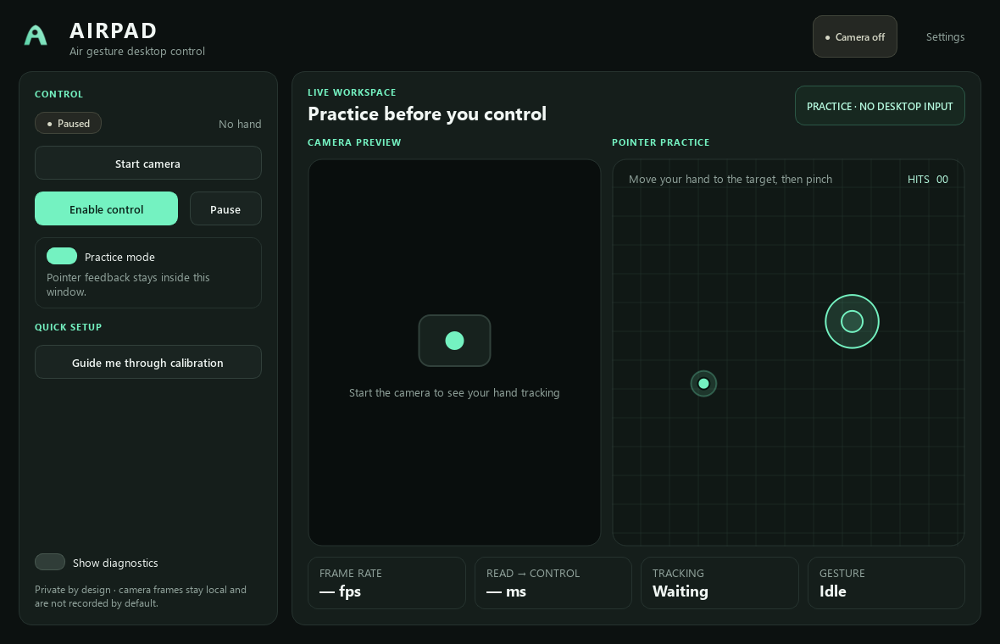
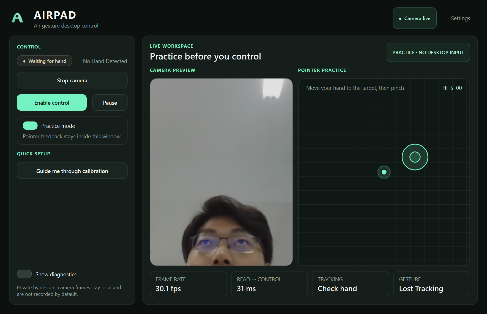
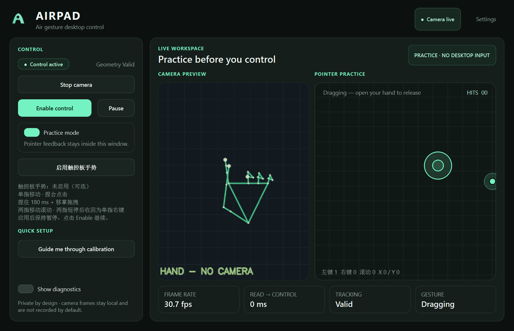
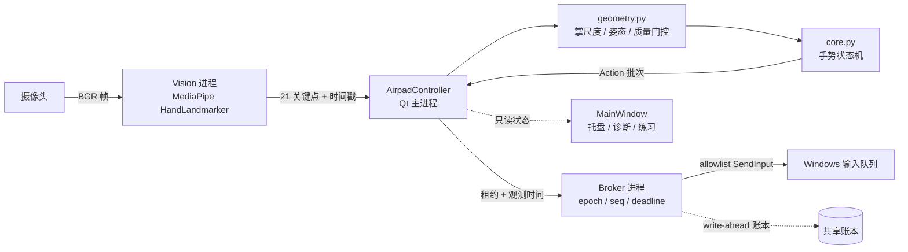

# AIRPAD

> 把摄像头变成一个**本地**的空间触控板：单指相对指针、捏合点击与拖拽、两指滚动，全部在本机处理，随时急停。

AIRPAD 是一个 Windows 桌面工具。它用 MediaPipe 在本地做手部关键点跟踪，把手掌尺度的相对位移换算成系统光标移动量，再通过一个**独立的输入 Broker 进程**注入经过 allowlist 校验的鼠标/键盘事件。相机、推理、输入三段彼此隔离，任何一段失效都朝"释放输入"的方向失败。

## 操控体验更新 · 2026-09-26

2026-09-27 点击防抖更新：指针增加随速度变化的停稳区；捏合期间的单帧掌位置尖峰、来回晃动不再误起拖或取消点击；接触/闭合阈值增加滞回。拖拽须连续同方向移动至少三帧、60 ms；清楚松开立即响应，模糊释放多确认一帧。研究来源与合成对比见 [点击防抖报告](docs/JITTER-FIX-REPORT.md)。现有校准无需重做。

如果已经校准好识别，**无需重新校准**。双击项目根目录 `Start-Practice.cmd`，点击“启用触控板手势”，再点 Enable，先在练习区体验：

| 操作 | 手势 |
|---|---|
| 移动 | 单指移动 |
| 左键 | 拇指与食指短捏、松开；捏合期间锁住指针位置 |
| 拖拽 | 捏住约 180 毫秒并移动手掌；弯曲食指不再被误算为拖拽 |
| 滚动 | 两指移动；进入滚动后不再补右键 |
| 右键 | 两指短暂停留，然后收回为单指 |
| 脱离 / 停止 | 开掌脱离；`Ctrl+Alt+Space` 急停 |

预设保留你现有的识别阈值，只开启两指滚动，并关闭缩放和三指实验动作。点击、右键、滚动在练习区有各自的反馈。满意后从根目录 `Start-AIRPAD.cmd` 进入桌面控制。

Windows EXE 位于 `dist/AIRPAD-Windows`。根启动器沿用项目 `runtime-data` 配置；独立便携包默认使用 `%LOCALAPPDATA%/AIRPAD`。详见 [Windows 使用说明](docs/WINDOWS-RELEASE-REPORT.md) 与 [操控修订计划](docs/CONTROL-UX-PLAN.md)。

---

## 项目状态（请先读这一段）

| 项 | 状态 |
|---|---|
| 代码实现 | 基本完整（airpad 包约 3,000 行 / 16 个文件） |
| 自动化测试 | **391 项全部通过** |
| 相机与模型 | 实机探测通过：**1280×720 / 约 30 FPS / 推理 p50 8.8 ms** |
| 手部识别（伸指、姿势、捏合） | 用户已确认识别正常；本轮保留个人阈值，重点优化操控逻辑 |
| 操控逻辑 | ✅ **默认即控制桌面**（启动开相机、手出现即接管、开掌为 Clutch） |
| 真实桌面输入（点击/拖拽/滚动/急停/崩溃释放） | ✅ **已在实机靶场验证**（多轮连跑，0 残留） |
| 端到端装配（几何→状态机→控制器→界面） | ✅ 已用脚本化轨迹验证，含骨架渲染证据 |
| 真实相机链路 | ✅ 已有实测（285 帧、12 帧有手、11 帧通过几何门并分类成功） |
| 真人手势体验（点击准确率/误触/疲劳） | ❌ **未验证** —— 用 `tools/click_eval.py` 自己跑出数据 |
| 安装包 | `dist/AIRPAD-Windows` 为包含运行时的目录式 EXE；另保留需 Python 的源码包，无签名安装器 |

> ⚠️ **如果你的手认不出来**，先跑 `tools\hand_check.py`（见下节），它会告诉我们是哪一步拒绝了你的手，并写出可以发给我校准阈值的 JSON。

---

## 第一次使用：先让阈值适配你的手

```bat
cd /d D:\codex\反代
.venv\Scripts\python.exe tools\hand_check.py --apply
```

它会引导你依次做**张开手掌 → 握拳 → 只伸食指 → 左右移动食指 → 捏合**五个动作（每段 2.5~4 秒），屏幕上实时显示每根手指的**伸展分数**、pinch 距离、几何门禁的拒绝原因和状态机判定。

结束后自动做两件事：

1. 把**每根手指的阈值**放在你"伸展"与"蜷起"分数分布之间的空档里；从你的横扫幅度推导**指针增益**（一次舒适横扫 ≈ 1100 counts 光标行程，与手大小无关）；pinch 的四个值（close / release / open / **接触深度 contact**）全部从你的张合分位推导
2. `--apply` 把它们写进 `runtime-data/profile.json`，**下次启动即生效**

固定的 0.62 是对别人的手的猜测；测一次自己的手，比反复调常数可靠。之后直接启动就是控制模式：

```bat
.venv\Scripts\python.exe -m airpad
```

想要只练习、不接管桌面：`python -m airpad --practice`。

现在的诚实结论是：**它已经能跑、能测、能打包，安全机制在真实桌面上验证过；但"真手用起来准不准、累不累"仍然没有数据**——那需要你亲自用手跑一次评估（下文有命令）。

README 里所有数字都标注了来源与产生它的命令；没有实测的项目一律写明"未测量"，不拿估计值充当结果。



> 上图是**相机未启动**时的真实界面（暂停状态、练习模式）。

**相机真实运行**（手未入镜，因此没有骨架）：



**脚本化手势的端到端运行**（拖拽状态，骨架由程序自己绘制）：



> 这张图的水印写着 `SYNTHETIC HAND - NO CAMERA`：背景是合成的，手部关键点是脚本生成的，用来证明整条管线接通。**它不是真人演示。**

**本仓库目前没有实机 Demo GIF。** 按设计规范，演示素材必须用真实设备录制、经本人同意后才可发布，不得用概念动画冒充，因此这里留空而不是放示意图。

---

## 功能支持矩阵

| 功能 | 状态 | 说明 |
|---|---|---|
| 相机采集 + 本地手部跟踪 | ✅ 实机验证 | **1280×720** 请求，约 30 FPS，推理 p50 8.8 ms |
| 手指伸展识别 | ✅ 已按花绳方案重写 | 连续 0–1 分数（距离比 + 直线度）+ 每指滞回；半蜷的手指不再导致失控 |
| 相对虚拟指针（掌尺度归一化 + One Euro） | ✅ 算法与端到端验证 | 食指伸展即接管，无需武装手势 |
| 开掌 Clutch | ✅ 算法与端到端验证 | 张开手掌立即释放并重建基线 |
| Pinch 点击 | ✅ 算法与端到端验证 | 阈值 0.42/0.62（花绳同量级，旧版 0.23 过紧）；**释放即点击、无点击窗口**；须捏到接触深度 `pinch_contact` 且由伸食指的姿势发起，擦过与握拳都不会误点 |
| Pinch 拖拽 | ✅ 算法与端到端验证 | 保持约 180 ms、接触确认和持续同方向掌位移（默认边界 0.12 掌尺度）；抖动尖峰不再起拖 |
| 两指滚动 | 🧪 实验性（默认关闭） | **默认下两指姿势仍驱动指针**；开启需 Settings 勾选 |
| 两指缩放 Zoom | 🧪 实验性（默认关闭） | 无混淆矩阵数据 |
| 三指 Task View / 切换桌面 | 🧪 实验性（默认关闭） | 需在 Settings 显式开启 |
| **默认即控制桌面** | ✅ 已实现 | 启动开相机；手出现即接管，手离开即释放 |
| 校准向导 + profile 持久化 | ✅ 已实现 | 开掌/移动/Pinch 三步，原子保存 |
| 系统托盘、诊断面板、练习靶场 | ✅ 已实现 | 练习模式（`--practice`）不注入任何桌面输入 |
| 输入 Broker（租约 / 急停 / 崩溃释放） | ✅ **实机验证** | 33 项测试 + 真实桌面靶场 |
| 全局急停 `Ctrl+Alt+Space` | ✅ 实机验证 | 真实按键 → OS 层释放 3.77–7.73 ms |
| 进程崩溃时的输入释放 | ✅ 实机验证 | 杀死持有按键的 worker → 7.07–25.83 ms 内释放 |
| 开机自启、双手模式、3D（Blender/SolidWorks） | ❌ 未实现 | 规划在 V1 之后 |
| 安装器（MSI/EXE）、Demo 素材、LICENSE | ❌ 未提供 | 见 [已知限制](docs/known-limitations.md) |

---

## 环境要求

- Windows 10 / 11 x64
- **CPython 3.12（必须是 3.12）** —— 依赖锁定在 MediaPipe 0.10.21，上游 1.x 换了运行时且元数据包含遥测条款，本项目刻意不跟随
- 一个能被 OpenCV 打开的 USB 或内置摄像头
- 磁盘约 1.25 GB（本机实测 `.venv` 为 1,250 MiB）
- 首次安装需要联网**仅一次**（下载 7.8 MB 模型）；安装完成后可断网运行

---

## 安装

双击 `Setup-AIRPAD.cmd`。它会：创建 `.venv` → 按 `requirements-lock.txt` 安装锁定依赖 → 下载并校验模型 → 运行 `doctor` 自检。

也可以手动执行：

```bat
py -3.12 -m venv .venv
.venv\Scripts\python.exe -m pip install -r requirements-lock.txt
.venv\Scripts\python.exe -m airpad install-model
.venv\Scripts\python.exe -m airpad doctor
```

`doctor` 输出示例（本机实测）：

```json
{
  "python": "3.12.14",
  "platform": "win32",
  "dependencies": {
    "mediapipe": "0.10.21",
    "numpy": "1.26.4",
    "opencv-contrib-python": "4.11.0.86",
    "PySide6": "6.8.3"
  },
  "model_ok": true,
  "camera_opened": false
}
```

## 启动

- 双击 `Start-AIRPAD.cmd`，或
- 命令行：`.venv\Scripts\python.exe -m airpad`

启动后的行为：**自动打开相机并进入桌面控制**。此时输入进程已经就绪（急停已注册）但**保持暂停**，直到镜头里出现一只有明确姿势的手才接管指针——所以你不动手，它就不会碰你的鼠标。

想让它完全不碰桌面：`python -m airpad --practice`（练习模式，永不创建输入进程）。

---

## 先跑一次真人评估（推荐第一步）

不接管桌面、不注入任何输入，用练习模式测你自己的点击准确率：

```bat
.venv\Scripts\python.exe tools\click_eval.py --targets 100
```

窗口里会依次出现 100 个目标，你把手移上去并捏合。结束后写入 `artifacts/click-eval.json`，包含命中率（recall）、精确率（precision = 命中 / 全部点击）、误触次数、误拖次数与中位获取时间。规范的 MVP 门槛是一次 100 目标评估。

```bat
:: 只检查工具本身能否运行（脚本手，命中数字无意义）
.venv\Scripts\python.exe tools\click_eval.py --source fixture --targets 3
```

---

## 手势

完整图解与判定阈值见 **[docs/gesture-guide.md](docs/gesture-guide.md)**。

| 手势 | 动作 |
|---|---|
| 开掌（五指伸直） | Clutch：立即释放所有输入并重建运动基线 |
| 手指伸出，中指收起 | 相对指针（食指移动 → 光标移动）；**无需任何武装手势** |
| 拇指 + 食指点捏（伸着食指）后张开 | 左键单击：闭合至少三帧、60 ms，接触状态至少两帧；达到 `pinch_open` 立即点击，仅到 `pinch_release` 则确认两帧；捏合期间光标冻结 |
| 捏住约 180 ms 并持续同方向移动手掌 ≥0.12 掌尺度 | 连续至少三帧、60 ms 的移动才起拖；清楚松开立即释放，单帧抖动不算拖拽 |
| 食指 + 中指**都明确伸出**并平移 | 默认仍是指针；开启 `Two-finger scrolling` 后才是滚动 |
| **张开手掌（四指伸展即可，拇指随意）** | Clutch：立即释放所有输入 |
| 三指并拢滑动 | Task View / 切换桌面（默认关闭） |
| 握拳 | 立即释放（不猜测意图）；**握拳时拇指-食指间距同样很小，但捏合只能由伸食指的姿势发起**，所以攥手不会在张开时误点 |
| `Esc`（窗口内）/ 界面 Pause | 暂停控制 |
| `Ctrl + Alt + Space` | **全局急停**：立即释放并暂停 |

---

## 安全与隐私

**安全设计**（详见 `docs/BROKER-REPORT.md`）：

- 输入注入由独立进程承担，UI 只通过租约提交动作；租约 = 最后一条新鲜观测 + 150 ms
- 观测过期上限 80 ms；过期、倒序、重复的批次一律拒绝，且不能续租
- 只接受 allowlist 中的动作类型，其它字符串直接被拒
- 按下/释放采用 write-ahead 账本：先记录"可能按下"再调用 SendInput，崩溃后父进程能据此补释放
- 父进程死亡、worker 卡死（>250 ms 无进展）、急停热键、后端异常，都会撤销 epoch 并释放
- 相机丢帧、手丢失、几何质量不合格、身份歧义、低帧率 → 一律释放，**不会补一次点击**
- **真实鼠标键被按住时全部合成输入暂停**（包括光标移动）：你在用真鼠标拖东西时，AIRPAD 不会跟你的手抢光标。判断会排除 AIRPAD 自己按下的键（否则拖拽会拒绝自己的移动）

以上机制不只在单元测试里成立：它们在真实桌面的可见靶场中实测过（见下方"实测数据"），包括**真实按下 `Ctrl+Alt+Space`** 与**在按住左键时杀死输入进程**两条故障路径，三次连跑都无残留按键。

**隐私**：

- 相机帧只在内存里流转，**默认不落盘**，任何路径都不会保存原始帧
- 模型只在显式执行 `install-model` 时下载一次并校验 SHA-256，运行期不会联网
- 本地日志只记录结构化指标（FPS、延迟、状态迁移、动作类型），不含帧数据与关键点坐标
- 详见 **[docs/privacy.md](docs/privacy.md)**

---

## 架构



三个进程彼此隔离，队列容量为 1 且只保留最新数据，避免延迟累积：

| 模块 | 文件 | 职责 |
|---|---|---|
| 视觉 | `airpad/vision.py` | 相机采集、镜像、MediaPipe 推理、有界关停 |
| 几何 | `airpad/geometry.py` | 手掌尺度、手指姿势、质量门控、手身份关联 |
| 核心 | `airpad/core.py`、`filtering.py` | 手势状态机、One Euro 自适应滤波、亚像素残差 |
| 输入 | `airpad/backend.py`、`broker.py` | ctypes Win32 边界、租约与看门狗、崩溃释放 |
| 运行时 | `airpad/runtime.py` | 三段编排、校准、练习、异常降级 |
| 界面 | `airpad/ui.py`、`style.py` | 主窗口、校准向导、诊断、托盘 |

`core.py` 不读墙钟、不碰摄像头、不碰磁盘，所有输入都是显式事件，因此可以确定性回放。

---

## 命令行

```bat
python -m airpad                       :: 启动：开相机并接管桌面控制
python -m airpad --practice            :: 只练习，不接管桌面（不创建输入进程）
python -m airpad --no-autostart        :: 只打开窗口，不开相机也不接管
python -m airpad doctor                :: 环境自检：依赖版本、模型哈希
python -m airpad install-model         :: 显式下载并校验模型（唯一联网命令）
python -m airpad replay trace.jsonl    :: 回放 landmark 或 HandSample 轨迹，输出动作与状态
python -m airpad benchmark             :: 核心状态机微基准（纯算法，不开相机）
python -m airpad run --smoke 5         :: 启动并在 5 秒后自动退出（冒烟用）
python -m airpad calibrate             :: 启动并直接打开校准向导
```

验证与评估工具：

```bat
:: 手部诊断：实时显示每根手指的分数、pinch 距离、姿势与状态机判定
.venv\Scripts\python.exe tools\hand_check.py

:: 真人点击评估（练习模式，需要你自己用手跑）
.venv\Scripts\python.exe tools\click_eval.py --targets 100

:: 真实桌面的输入验收靶场（只在自己的窗口里注入，含急停与崩溃释放故障路径）
.venv\Scripts\python.exe tools\windows_input_probe.py --emergency --crash --cycles 5

:: 脚本化端到端：真实控制器 + 真实界面 + 脚本关键点，练习模式
.venv\Scripts\python.exe tools\replay_smoke.py

:: 真实相机端到端（练习模式，不保存任何帧）
.venv\Scripts\python.exe tools\integration_smoke.py --seconds 10

:: 相机与模型诊断（只输出聚合值）
.venv\Scripts\python.exe tools\camera_probe.py --device 0 --backend auto --frames 150

:: 滤波基线对比（EMA / One Euro / Kalman 走同一条轨迹）
.venv\Scripts\python.exe tools\filter_compare.py

:: 重新生成 landmark fixture（自带几何门禁自审）
.venv\Scripts\python.exe tools\make_fixture.py

:: 打包 / 文档链接检查 / 依赖许可表 / 文档计数核对
.venv\Scripts\python.exe tools\package.py --zip --verify
.venv\Scripts\python.exe tools\link_check.py
.venv\Scripts\python.exe tools\doc_check.py
.venv\Scripts\python.exe tools\license_report.py
```

---

## 测试

```bat
.venv\Scripts\python.exe -m pytest tests -q
```

本机最新结果：**391 passed**（交付包内同样通过；含真实控制链路与测量工具的集成测试，约 25 秒）。

| 测试文件 | 数量 | 覆盖 |
|---|---|---|
| `tests/test_broker.py` | 41 | 租约过期、陈旧/重复批次、allowlist、部分失败、账本、看门狗、真实子进程 dry-run 死亡 |
| `tests/test_geometry_robustness.py` | 28 | 9 种手势 × 5% 抖动 × 20 个随机种子、±40° 旋转、透视压缩、远近变化、拇指并拢的开掌、pinch 尺度不变性 |
| `tests/test_click.py` | 24 | 点击语义：快捏/慢捏/连捏、擦过和孤立噪声不点、握拳不点、捏合锁定指针、持续越界才起拖、原始 pinch 阈值与接近冻结回归 |
| `tests/test_core_recovery.py` | 20 | 恢复类回归：丢失后重新握合不得补交中断的 pinch、拖拽超过两秒仍持续到释放、unknown 姿势不得埋下稍后才生效的 pinch、待定 pinch 必须超时且需重新分开才能再用 |
| `tests/test_runtime.py` | 27 | 控制模式默认值、练习模式不创建输入进程、相机故障取消控制、**手判不出来时主动提示怎么办**、慢帧自动恢复、首帧握手重试、设置原子生效 |
| `tests/test_thresholds.py` | 26 | 按真实手测量阈值与增益：空档定位、**窄空档也照常测**、模糊区间锚定在蜷起中位数之上、**横扫太小拒绝改增益**、分布重叠时退回默认、低分手必须被救回、**点击所需的接触深度也从这只手推出来**、**捏合阈值不可达时拒绝推导而不是截断**、**增益上限与 profile 接受范围一致且被夹住时会自报**（长指甲捏不到底的手会拿到更深的接触线，且推出来的四个值必须是合法 profile） |
| `tests/test_control_path.py` | 9 | **真实控制链路集成测试**：脚本手 → 状态机 → 控制器 → BrokerState → 后端；点击/拖拽/滚轮/缩放、物理急停释放、**按住真实鼠标键时连光标移动都拒绝**、账本归零，以及**"默认读不出的手在测量后能接管"这条产品承诺的端到端验证** |
| `tests/test_profile.py` | 12 | profile 是测量结果的唯一载体：**逐字段往返一致（含 null 模糊区间）**、8 种损坏形式必须被拒绝、损坏时退回默认并明示、测量值必须到达实时滞回区间 |
| `tests/test_pinch_depth.py` | 8 | **点击接触深度必须属于被测量的那只手**：默认仍是验证过的 0.25、量出大捏合区间的手拿到能捏到的深度、改 close 时深度跟着走、旧 profile（没有该字段）按自己的区间补齐而不是套默认值、坏值仍被拒绝、浮点边界 0.55 不得被误拒 |
| `tests/test_hand_check.py` | 17 | 测量报告必须指明该重做哪一步（帧数不足/某指分不开/空档窄/横扫太小/pinch 未分开/**横扫小到增益被夹在上限**）；程序运行时拒绝写 profile；**数据目录不存在不得被误判为程序在运行**；**不合格的测量拒绝写入而不是覆盖掉一个能用的 profile**（引脚相位过薄时明确说"什么都没写"，pinch 相位不参与这个拒绝，因为它有自己的回退） |
| `tests/test_hand_check_fixture.py` | 7 | **测量工具走真数据**：脚本手跑完五个相位，五根手指全部测出阈值、增益与 pinch 从样本推导、**点击接触深度一并写入且能通过 profile 校验**、写入的 profile 能被应用加载 |
| `tests/test_resources.py` | 8 | **唯一联网代码**：哈希不匹配必须拒绝、超限与断连不得留残留文件、已有合法模型绝不联网、doctor 保持离线 |
| `tests/test_telemetry.py` | 6 | 本地日志：JSONL 往返、队列满时立即丢弃不阻塞、关闭幂等、轮转有界 |
| `tests/test_core.py` | 15 | Pinch 点击/取消、拖拽丢失释放、Clutch 重建、亚像素运动、两指默认仍是指针 |
| `tests/test_hand_model.py` | 12 | 合成手模型必须精确提取出它声称的尺度/捏合/姿势；握拳必须被拒绝而不是被猜 |
| `tests/test_vision.py` | 13 | 最新帧槽、镜像与色彩、21 点序列化、缺模型、卡死 worker、**必须请求 1280×720**、**时间戳必须严格递增** |
| `tests/test_replay_fixture.py` | 10 | 走**实时同一条滞回路径**验证确定性、单次点击、单次拖拽、丢失释放 |
| `tests/test_click_eval.py` | 9 | 点击评估打分逻辑：命中、误触、超时、拖拽、半径、报告指标 |
| `tests/test_ui.py` | 15 | 控制模式为默认、**状态如实显示在等什么**、控制器接线、练习靶场、校准步骤、托盘、单次关闭 |
| `tests/test_geometry.py` | 8 | 掌尺度、姿势判定、**画面边缘容忍**、**两手时选中指点的那只**、歧义拒绝 |
| `tests/test_filter_compare.py` | 5 | 滤波对比的不变量：平滑必须降抖动、不得丢失行程、因果滤波不得超前 |
| `tests/test_portable.py` | 5 | 便携边界：冻结后数据落在用户目录、doctor 报告不污染 stdout、自检离线跑在子进程、练习与校准启动绝不打开桌面控制 |
| `tests/test_package.py` | 4 | 打包边界：只收显式合成的产物（**真人相机录像与用户状态绝不进包**）、拒绝往 dist 外重建、拒绝清理 dist 根、清单能查出被改过的文件 |
| `tests/test_cli.py` | 4 | doctor、replay（HandSample 与 landmark 两种输入）、帮助文本的编码安全 |
| `tests/test_doc_check.py` | 7 | 文档与事实一致性检查器本身：错计数/缺行/多行/缺总数都必须被抓到，并**真跑一次**比对 README 与本套件 |
| `tests/test_touchpad_core.py` | 29 | 触控板意图：掌位移拖拽、释放回弹、连续接触、两指右键与滚动互斥、真实几何滞回链路 |
| `tests/test_jitter.py` | 22 | 点击防抖：掌位置尖峰、往返抖动、接触/闭合/释放滞回、停稳与持续微调、宽捏合范围、真实几何链路和 200 次合成点击 |

测试全部使用替身（`RecordingBackend` / dry-run / 离屏 Qt / 合成手模型），**不会**注入真实桌面输入、不会开摄像头、不会写帧。

---

## 实测数据

### 真实桌面输入（`tools/windows_input_probe.py --emergency --crash --cycles 5`）

在真实 Windows 会话中对**自建可见窗口**注入，三次连跑，每次 13 个阶段全部通过（每列对应 `artifacts/windows-input-probe*.json` 里的那一次）：

| 指标 | run 1 | run 2 | run 3 | 门槛 |
|---|---|---|---|---|
| 租约到期 → OS 收到释放 | 157.11 ms | 155.37 ms | 151.01 ms | ≤250 ms |
| 真实 `Ctrl+Alt+Space` → OS 收到释放 | **10.92 ms** | 7.73 ms | 4.43 ms | — |
| 按住左键时杀死输入进程 → OS 收到释放 | 19.67 ms | 25.83 ms | 7.07 ms | ≤1000 ms |
| 关闭后仍被占用的输入 | `[]` | `[]` | `[]` | 必须为空 |
| 5 次连续点击循环后的残留 | `[]` | `[]` | `[]` | 必须为空 |

另外验证：单击到达窗口（4.51–12.49 ms）、拖动 down/move/up、垂直滚轮、`Ctrl+滚轮`、租约到期自动释放。run 1 跑在**最终代码**上；run 2/3 在点击判定信号改动之后、profile 深度修正之前（那两处只影响阈值来源，不碰注入时序），三跑的注入路径相同。

### 脚本化端到端（`tools/replay_smoke.py`）

真实 `AirpadController` + 真实 `MainWindow`，只把视觉进程换成脚本关键点：

- 131 帧全部投递，相机状态 `running`
- 状态迁移覆盖 `CLUTCH → TRACKING → PINCH_START → PINCH_HOLD → DRAGGING → LOST_TRACKING`（默认配置下两指滚动是关的，所以 `TWO_PENDING/SCROLLING` 不可达；开 Settings 里的 `Two-finger scrolling` 才会走那条分支）
- 练习计数：命中 **1 次点击**，拖拽进入并释放（`click → left_down → left_up` 各一次），指针移动到位
- **没有创建任何桌面输入 Broker**（断言通过）
- 三张截图内均检出程序自己绘制的骨架像素（258/274/274 条骨、6859/7143/7013 个关节点）

原始数据与截图：`artifacts/replay-smoke.json`、`artifacts/replay-smoke-*.png`。

### landmark fixture 回放（`tools/make_fixture.py` + `airpad replay`）

131 个观测帧 / 4.367 s，**全部通过几何质量门**，手身份连续（131 帧 `Hand detected`）。`airpad replay` 走的是实时同一条滞回与点击判定路径，且**只读内置默认 profile**（不受你测量的 profile 影响，因此这两列可复现）：

| 输出 | 默认 profile | 加 `--experimental`（开两指滚动/三指） |
|---|---|---|
| move | 53 次（合计 3134 counts） | 41 次（合计 1891 counts） |
| click | 1 次（1.733 s） | 1 次（1.733 s） |
| left_down / left_up | 1 / 1（2.667 s / 3.000 s） | 1 / 1（2.667 s / 3.000 s） |
| wheel | 0（默认下两指姿势仍是指针） | 5 次（252.0 单位） |
| release_all | 2 次（0.033 s 首帧未跟踪 + 4.367 s 手离开画面） | 2 次（同左） |

> 上一版这张表记的是 `move 39 / click 1 / wheel 6 / release_all 1`，是**旧引擎 + `--experimental`** 下的数字：点击改动后指针在捏合与收拢期间不再累积位移，move 次数随之变化；`release_all` 当时漏记了首帧那一次；wheel 那行则是因为默认配置下根本不该有滚轮事件。现在两套配置分开列。

### 真实相机

| 指标 | 150 帧探测（`docs/VISION-REPORT.md`，旧 640×480） | 本机 720p 复测 | 8 秒端到端（720p） |
|---|---|---|---|
| 采集分辨率 | 640×480 | **1280×720** | 1280×720 |
| 处理帧率 | 28.983 FPS | 29.96 FPS | 29.94 FPS（峰值 32.26） |
| 推理延迟 p50 | 15.551 ms | **8.82 ms** | 15.47 ms |
| 推理延迟 p95 / max | 16.362 / 30.835 ms | 15.78 / — ms | max 18.45 ms |
| 读取→控制器延迟 | 未测 | — | **15–32 ms**（输入预算 80 ms） |
| 保存的帧 | 0 | 0 | 0 |

分辨率提高 4 倍而推理耗时几乎不变——MediaPipe 内部会把输入缩放到模型尺寸，收益是**关键点精度**（捏合与伸指都是距离比值，像素越细越稳）。原始数据：`artifacts/integration-smoke.json`。

### 滤波基线对比（`tools/filter_compare.py`）

同一条脚本轨迹（60 帧静止 + 60 帧匀速），只有平滑环节不同：

| 方案 | 静止抖动 RMS (counts) | 静止峰值 | 匀速中位 counts/帧 | 相对 raw 的滞后 | 总行程 counts |
|---|---|---|---|---|---|
| raw（不平滑） | 5.246 | 13 | 5.0 | 0.0 | 304 |
| EMA (α=0.35) | 1.308 | 5 | 5.0 | 0.200 | 295 |
| **One Euro（出厂默认）** | **0.902** | **4** | 5.0 | 0.283 | 291 |
| Kalman (q=1e-4, r=1e-2) | 1.207 | 6 | 5.0 | 0.183 | 297 |

结论：出厂默认的 One Euro 静止最稳（抖动比 raw 低 83%），代价是匀速时每帧多滞后约 0.28 counts（相对中位 5 counts/帧约 6%）；各方案总行程相差 <5%，没有滤波器吞掉或凭空产生位移。

### 核心状态机（`python -m airpad benchmark`）

| 指标 | 实测值 |
|---|---|
| 样本数 | 10,000 |
| 单步耗时 | p50 **3.7 µs** / p95 3.8 µs |
| 产出动作数 | 9,654 |

这是**纯算法微基准**，与相机、渲染、OS 注入无关，不能当作端到端延迟。

**未测量**：真人手感、相机到可见指针的端到端延迟、真实第三方应用内的点击准确率。

### 模型

| 项 | 值 |
|---|---|
| 文件 | `models/hand_landmarker.task` |
| 大小 | 7,819,105 字节 |
| SHA-256 | `fbc2a30080c3c557093b5ddfc334698132eb341044ccee322ccf8bcf3607cde1` |
| 来源 | MediaPipe 官方 float16 hand_landmarker（见 `airpad/resources.py`） |

---

## 交付包

```bat
.venv\Scripts\python.exe tools\package.py --zip --verify
```

在 `dist/AIRPAD-<version>/` 生成目录式绿色包，排除缓存与用户数据，可整目录拷到干净机器后运行 `Setup-AIRPAD.cmd`。

最近一次本机实测：

```
Package   : dist\AIRPAD-0.1.0
Files     : 69 (8.3 MiB)
Verify    : [PASS] doctor (model hash inside package)   "model_ok": true
            [PASS] GUI boot (offscreen, --smoke 3)      exit=0
Manifest  : 69 files, tree matches manifest
Archive   : dist\AIRPAD-0.1.0.zip (6.1 MiB)
```

`--verify` 的三项保障（可复现）：

1. **包内自检**：在包目录内运行 `airpad doctor`，证明包**自带的**模型哈希正确、不依赖仓库原有路径
2. **包内启动**：在包目录内离屏启动 GUI 并自动退出，退出码 0
3. **清单一致**：`MANIFEST.json` 记录每个文件的字节数与 SHA-256，并校验包内**没有清单之外的多余文件**（校验过程用 `PYTHONDONTWRITEBYTECODE` 并自动清理残留，不会污染它正在检查的包）

> 这是**目录式**绿色包，不是 MSI/EXE 安装器：没有签名、没有注册表项、没有卸载向导，删除目录即卸载。

---

## 已知限制

完整清单见 **[docs/known-limitations.md](docs/known-limitations.md)**。要点：

- 真实输入已在**自建靶场窗口**内验证；**未**在第三方应用、多显示器、混合 DPI 下验证
- 无真人可用性数据：点击精度/召回、误触率、20 分钟连续使用疲劳度全部未测量（工具已备好）
- 锁屏/休眠/切用户、显示器插拔、物理按键抢占的实测：未做
- 仓库的 landmark fixture 是**脚本生成**的，不是真人录制：它验证管线与状态机，不验证识别器准确率
- 无 MSI/EXE 安装器、无开机自启、无诊断导出、无 JSON 应用映射

## Roadmap

按 [docs/AIRPAD-IMPLEMENTATION-ORDER.md](docs/AIRPAD-IMPLEMENTATION-ORDER.md) 推进：

- [x] Stage 0–1 相机与手部跟踪
- [x] Stage 2–3 相对指针、滤波、Clutch（含 EMA/One Euro/Kalman 对比与 landmark fixture）
- [x] Stage 4 Broker 与指针/点击/拖拽/滚动（单元测试 + **实机靶场验收**）
- [x] Stage 9–11 校准、UI/托盘、实验性 Zoom 与三指
- [ ] **真人评估**：`tools/click_eval.py` 跑 ≥100 目标，产出精度/召回与误触统计
- [ ] 第三方应用、多显示器、混合 DPI、锁屏恢复的实机测试
- [ ] Stage 12 V1 打包：MSI/EXE 安装器、依赖矩阵、1h/4h 稳态与断网测试
- [ ] Stage 13–14 双手模式、本地 3D Viewer、Blender / SolidWorks 适配

## 待办（需要仓库所有者决定）

- **LICENSE 尚未选择** —— 本项目依赖 PySide6（LGPL-3.0 / GPL / 商业三选一），发布前需要据此确定许可策略
- 实机 Demo GIF / 视频素材
- `docs/` 中设计与阶段文档为中文，模块验证报告为英文，尚未统一

## 文档索引

| 文档 | 内容 |
|---|---|
| [docs/AIRPAD-DESIGN-SPEC-v1.0.md](docs/AIRPAD-DESIGN-SPEC-v1.0.md) | 完整设计规范（算法、状态机、错误处理、MVP/V1 定义） |
| [docs/AIRPAD-IMPLEMENTATION-ORDER.md](docs/AIRPAD-IMPLEMENTATION-ORDER.md) | 15 阶段实施顺序与验收标准 |
| [docs/IMPLEMENTATION-PLAN.md](docs/IMPLEMENTATION-PLAN.md) | 本交付的实施计划与进度（含证据出处） |
| [docs/gesture-guide.md](docs/gesture-guide.md) | 手势图解与判定阈值 |
| [docs/privacy.md](docs/privacy.md) | 隐私与数据处理说明 |
| [docs/known-limitations.md](docs/known-limitations.md) | 已知限制与未验证项 |
| [docs/VISION-REPORT.md](docs/VISION-REPORT.md) | 视觉层验证报告（含实机相机数据） |
| [docs/BROKER-REPORT.md](docs/BROKER-REPORT.md) | 输入 Broker 评审与安全边界 |
| [docs/UI-REPORT.md](docs/UI-REPORT.md) | 界面验证报告 |
| [THIRD_PARTY_NOTICES.md](THIRD_PARTY_NOTICES.md) | 第三方依赖与许可 |
