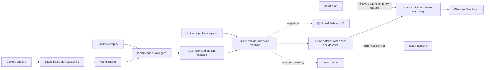

# AIRPAD DESIGN SPEC v1.0

**Vision-based Spatial Multi-Touch Interface**  
**Turn any webcam into a spatial multi-touch trackpad.**

日期：2026-09-11 · 状态：系统设计基线，待实机验证 · 目标平台：Windows 10/11 x64

本文交付产品、交互、算法、工程接口和验收规范。它不是已经实现的软件说明。所有数值均为标注的初始参数或验收目标；本次没有运行摄像头、注入系统输入或测得性能。后续阶段见 [Recommended Implementation Order](./AIRPAD-IMPLEMENTATION-ORDER.md)。

## 设计结论

AIRPAD 应当首先成为一个可以随时放下手、重新接管的相对指针工具。桌面模式使用单手二维相对位移，手部结构用于判断接触、意图和质量；单目估计的深度不承担桌面点击判定。双手和 3D 操作在基础交互经过用户测试后加入。

| 决策 | v1.0 选择 | 原因 |
| --- | --- | --- |
| 实时视觉 | MediaPipe Tasks Hand Landmarker，CPU 起步 | 先验证成熟关键点模型，不训练新模型 |
| 实时编排 | Python；纯算法核心与 Qt、摄像头、Win32 解耦 | 能回放、能测量、迭代快 |
| 指针 | 掌尺度归一化的相对位移 | 避免手回到某处时光标跳回某处 |
| 平滑 | 几何质量门控 + One Euro + 带迟滞的静止锁定 | 在低速稳定与高速响应之间调节 |
| 点击/拖拽 | 松开提交点击；保持并移动才按下左键 | 抑制收拢手指造成的误拖拽 |
| 滚动/缩放 | 两指进入候选，依据平移/张合竞争，锁定至退出 | 同一帧只能有一个连续操作所有者 |
| 输入 | 独立 Input Broker，ctypes 调用 SendInput | 集中输入所有权、错误处理和超时释放 |
| 应用 | PySide6 Widgets + System Tray | 足够完成设置、引导、HUD 与生命周期管理 |
| 安全 | 输入租约、进程互监、失踪立即释放、重新武装 | 不依赖模型正确，也不只依赖 finally |
| 证据 | 固定 landmark 回放 + Win32 集成测试 + 真人任务测试 | 分开验证算法正确性、系统行为与体验 |

## 01. 产品定义

**主要场景**：坐姿、普通 RGB 摄像头、肘部可以支撑，进行指向、网页浏览、演示和轻量窗口操作。交互区域是摄像头前一块舒适的工作空间；它不是具有真实接触反馈的平面。

核心价值是免接触、可见的控制状态和连续操作。成功标准包括精确指向、可信点击、自然撤出和可恢复失败，不能只统计“识别到了多少手势”。

产品边界：不承诺替代整天的鼠标工作，不承诺游戏竞技、精密制图、系统安全桌面操作，不把摄像头估计的坐标宣传为精确的物理深度。空中举手的疲劳及缺少触觉反馈必须通过任务测试评估；UI 引导低位手势、肘部支撑和随时休息。

运行前提先作为假设验证：640×480 或更高的有效画面、实际输出约 30 FPS、手部不长期过曝/欠曝、主要手掌面向摄像头。发布时给出测试过的设备和条件，而不是承诺所有摄像头都达到同一性能。

## 02. UX Interaction Model

用户经历三个层级：**应用允许控制 → 手进入控制会话 → 当前动作取得输入所有权**。打开程序、看到一只手，都不等于获得鼠标控制权。

| 用户状态 | 产品反馈 | 输入行为 |
| --- | --- | --- |
| 首次启动/恢复进程 | Paused，显示启用按钮和急停热键 | 不注入 |
| Enable 后等待 | Ready，提示张开手掌再伸出食指 | 不注入 |
| 开掌后形成稳定食指姿态 | Tracking，低干扰状态点 | 从当前位置开始相对移动 |
| 展开五指或姿态不明确 | Clutch / Reposition | 冻结、释放、丢弃累计位移 |
| 明确按 Pause | Paused | 只有 UI/热键重新 Enable 才能恢复 |
| 手丢失或交叉 | Tracking lost / Ambiguous hand | 释放，恢复时重新武装 |
| 长期无手 | Idle；超时可关闭摄像头 | 不自动重新启用控制 |

**Clutch 不是开关式暂停。** 五指展开期间可以移动手到任意位置；恢复控制姿态后重新设置运动基线。重新定位的轨迹永不补发。不能要求用户把手准确移回某个虚拟原点。

普通姿态过渡也会短暂冻结；不确定时优先冻结而不是猜测。由 Clutch 恢复需要 pinch 已张开、同一只手稳定且控制姿态持续约 120 ms；从 Tracking lost 恢复要求先确认开掌再控制，约 180 ms。明确暂停不能被任何手势解除。

全局紧急暂停建议 Ctrl+Alt+Space，由 Broker 注册并处理；注册冲突时在启用控制前要求选择可用组合。提供托盘 Pause、主窗口 Pause 和五指 Clutch 三个出口。热键冲突、没有托盘的环境都不能留下不可访问的后台控制器。[RegisterHotKey 官方接口](https://learn.microsoft.com/en-us/windows/win32/api/winuser/nf-winuser-registerhotkey)。

## 03. 手势规范

以下手势均须通过质量检查和时间一致性检查。除特别注明外，表中持续时间和阈值是实验起点，不是人体通用常数。

| 操作 | 进入条件 | 连续行为 | 完成/取消规则 |
| --- | --- | --- | --- |
| Cursor | 食指伸展，中/无名/小指弯曲；拇指可自然张开 | 食指尖相对移动 | 姿态改变立即冻结，重新建基线 |
| Left click | 从已武装 Cursor 进入拇食指 Pinch | 收拢及保持阶段冻结光标 | 合格短 Pinch 的释放提交一次 down/up |
| Drag | 合格 Pinch 保持至少 180 ms，掌中心移动超过 0.10 掌单位 | 一次 left-down 后，按掌中心相对位移拖动 | Pinch 释放立即 left-up；不再补 click |
| Scroll | 食/中指伸展，其余弯曲，双指平移证据胜出 | 两指中点控制垂直/水平滚动 | 退出双指、Clutch、质量失败立即结束 |
| Zoom | 相同双指姿态，张合证据胜出 | 掌尺度归一化的双指距离对数变化 | Ctrl+Wheel 短事务，退出即结束 |
| Task View | 食/中/无名指伸展，明确上滑 | 一次 Win+Tab | 一次手势只触发一次，退出后才能重武装 |
| Desktop switch | 三指左右滑 | Win+Ctrl+Left/Right | 同上；没有相邻桌面不自动创建 |
| Clutch | 五指展开；或安全策略判定不能控制 | 无移动，释放 AIRPAD 持有的输入 | 开掌后稳定 Cursor 姿态重新接管 |

三指下滑默认不映射“显示桌面”，避免意外隐藏工作。切应用使用 Task View 后指向点击；可选 profile 将左右滑改为 Alt+Tab/Alt+Shift+Tab，但一次模式只使用一种左右语义。上述快捷键对应 Windows 官方定义。[Windows 快捷键](https://support.microsoft.com/en-us/windows/keyboard-shortcuts-in-windows-dcc61a57-8ff0-cffe-9796-cb9706c75eec)。

双击：两次完整 Pinch 周期形成两个普通 click，由 Windows 按其双击时间/位置规则识别；不等待第二次而延迟第一次。右键是 V1 可选手势，暂采用稳定 Cursor 下拇指与中指短捏合；须单独校准并通过混淆测试后开启，不作为 MVP 阻塞项。

Scroll 与 Zoom 均先提供训练页。不能顺畅完成双指张合的用户可以关闭 Zoom，保留高可靠滚动。V1 禁用惯性滚动；停止动作后不继续移动内容。

## 04. System Architecture



部署为三个进程，按阶段逐步引入：

| 进程 | 职责与线程 | 不承担的职责 |
| --- | --- | --- |
| App/Supervisor | Qt 主线程；轻量监控线程监听 Broker 进程句柄、共享输入账本；管理配置和子进程 | 不运行视觉推理 |
| Vision Worker | 采集线程写最新帧；单一控制线程顺序执行跟踪、特征、FSM | 不直接注入；不写 Qt 控件 |
| Input Broker | 小消息循环、Win32 输入、热键、会话事件、超时租约 | 不加载 Qt/OpenCV/MediaPipe，不执行插件代码 |

三进程的理由是隔离摄像头阻塞与输入释放，并为输入进程自身死亡保留恢复者；不是为每个算法模块创建一个进程。先使用 Python 与 ctypes。只有实测表明 Broker 调度或依赖启动成为瓶颈，才将这个小边界迁至 C++/Rust，保留协议。

IPC 使用本地、当前用户权限下的有界通道。动作采用保序 FIFO，最多容纳 2 个未消费的帧批次；每批次包含该帧的 move/down/up 顺序。相对 delta 不能像相机帧一样被覆盖，否则会丢失距离；默认也不合并成大位移，避免改变 Windows 加速度行为。Pause/ReleaseAll 使用独立优先信号，撤销整个 epoch 后可丢弃该 epoch 的全部旧动作。队列溢出时撤销会话，不能只丢掉一个 left-up。

完整视频不进入消息队列。HUD 开启时，采集线程将缩小预览放入带序号的双缓冲共享内存；UI 读一致快照并复制后绘制，不能读取正在覆盖的缓冲。HUD 关闭即停传预览，控制管线继续运行。

## 05. 技术选型与替代方案

以下性能与成本比较是工程预判，最终用同机测试校验。

| 领域/方案 | 优点 | 缺点 | 性能/成本/可靠性判断 | 选择 |
| --- | --- | --- | --- | --- |
| A. Python + MediaPipe + Qt | 开发快、组件现成、便于回放 | 需约束线程和部署依赖 | 原生模型做主要计算；成本低；需进程隔离 | 默认 |
| B. Python + ONNX Runtime 自组检测/关键点 | 模型和执行器可替换 | 自管 ROI、跟踪、预处理及模型许可 | 性能须测；成本中高；集成风险较高 | Tracker 接口后备 |
| C. 全 C++/Rust 桌面管线 | 可控制内存、调度及部署 | 视觉/UI 集成与调试投入大 | 潜在开销较低；不能消除摄像头延迟 | 有测量证据再迁移 |
| PySide6 Widgets | 托盘、表单、事件循环齐全 | 视觉自由度低于 QML | 足够；成本低 | 默认 |
| Qt Quick/QML | 动效与自定义布局强 | 增加 QML/Python 边界 | UI 收益不影响核心手感 | 后续可换 |
| C#/WPF + Python worker | 原生 Windows 体验 | 两种运行时和 IPC 运维 | 可靠，但交付成本较高 | 不选 |

依赖策略：在独立 venv 选择一组确认有 Windows x64 wheel 的 CPython、MediaPipe、NumPy、OpenCV、PySide6 版本并锁定；Python 3.12 作为首个兼容性探测目标，不预先保证所有现装版本兼容。仅装一个提供 cv2 的 OpenCV distribution。官方安装前提以 [MediaPipe Python setup](https://developers.google.com/edge/mediapipe/solutions/setup_python) 为准，阶段 0 用实际 import 和模型加载记录结果。

不把 PyTorch 或 GPU 作为必需依赖；本任务没有训练需求。模型文件单独锁定版本、来源和 SHA-256，校验失败不能启动输入。安装包携带或通过明确的首次设置下载模型；离线模式绝不隐式联网。发布时核对依赖与模型的再分发许可并附 notices。

## 06. Hand Tracking 方案

选 MediaPipe Tasks Hand Landmarker，使用 VIDEO 模式在专用线程同步处理带递增时间戳的最新摄像头帧。这样便于跟踪帧的消费与动作对应关系。LIVE_STREAM 可作性能对照，但其忙碌时会忽略新输入，需要额外管理回调生命周期。两种模式都可利用帧间跟踪减少重复手掌检测。[官方 Python 指南](https://developers.google.com/edge/mediapipe/solutions/vision/hand_landmarker/python)。

初始 `num_hands=2`，用于检测另一只手和身份歧义；只有一只手拥有桌面控制权。若低端机性能不达标，可提供明确标注的单手配置，但不声称它能可靠发现双手交叉。

HandTrack ID 由 AIRPAD 分配。关联代价综合掌中心预测距离、尺度变化、骨架形状和 handedness；handedness 仅为弱提示。近似同价关联、遮挡交叉或尺度突变进入 AMBIGUOUS，释放并等待开掌重武装，不把旧轨迹直接交给新手。Auto 只在未持有输入时选择控制手，选择后保持到会话结束。

关键点输出包含图像坐标、相对手中心的 world landmarks、左右手分类。**左右手 score 不是 tracking confidence；公开结果不提供一个可以直接当作每点精度的置信度数组。** `min_tracking_confidence` 是内部跟踪门槛，不能直接作为 HUD 的实时测量值。[HandLandmarkerResult API](https://developers.google.com/edge/api/mediapipe/python/mp/tasks/vision/HandLandmarkerResult)。

自定义 `TrackingQuality` 用可解释条件构成：坐标有限、所需点未出界、掌尺度合理、骨段比例连续、姿态没有严重侧转、关联唯一、帧新鲜。输出 valid/reason；附加 0–1 heuristic quality 只能标注为“几何质量评分”，不能标成概率。模型没有给出的 detector/presence score 保持 null。

预处理明确规定镜像且只做一次：BGR→RGB，水平镜像后输入 tracker，HUD 显示相同图像；用户向右移动在这套控制坐标中应增大 x。左右手标签在校准页实际核验，不假定不同 API/模型版本具有相同镜像约定。模型相对深度用于辅助姿态判断，桌面控制不依赖世界坐标绝对平移。

## 07. Coordinate / Relative Motion Algorithm

### 7.1 坐标、掌尺度和距离

设模型点为 `(x_i,y_i)`，输入帧宽高为 `W,H`。先转为等距图像坐标：

```text
p_i = (x_i * W/H, y_i)                      # 单位：图像高度
s_raw = 0.5 * (norm(p_5-p_17) + norm(p_0-p_9))
c = mean(p_0, p_5, p_9, p_13, p_17)         # 掌中心
r_pinch = norm(p_4-p_8) / s_raw             # 拇食指距离，掌单位
r_two = norm(p_8-p_12) / s_raw              # 食中指距离，掌单位
```

必须修正宽高比，不能直接对分别按 W/H 归一化的 x/y 求欧氏距离。尺度来自掌骨而非手框，避免手指收拢改变尺度。掌严重侧转、掌骨投影退化、尺度小于校准可用范围时拒绝输入，不能仅靠 epsilon 把小分母变成巨大增益。

归一化只能近似抵抗距离变化，不能抵消所有透视、遮挡及摄像头视角变化。校准记录可用尺度范围与掌宽/掌长比例区间，HUD 引导用户回到舒适距离；它不显示未经测量的厘米距离。

### 7.2 相对运动

Cursor 的控制点为食指尖 p8；Drag 为掌中心 c；Scroll 为两指中点。每次控制点或模式变化均重置基线和滤波器，不跨模式求差。

```text
dt = t_current - t_previous                 # 单调时钟，秒
d_raw = (anchor_current - anchor_previous) / mean(s_current, s_previous)
q_current = q_previous + d_raw              # 累积虚拟掌单位轨迹
q_filtered = filter(q_current, dt)
d_filtered = q_filtered - previous_q_filtered
u = sensitivity_counts_per_palm * gain(speed) * d_filtered
```

**对位移除以尺度，而不是对归一化位置做差。** `p_current/s_current - p_previous/s_previous` 会在尺度变化时引入伪运动。对 s 使用有界、时间感知的缓慢滤波；大幅尺度/姿态变化直接 Clutch，不用限幅掩盖错误。缓慢前后移动仍可能有透视平移，纳入静止与距离变化测试，不宣称完全消除。

`u` 单位为相对输入 count，不先等同物理屏幕像素；Windows 会处理它。保存小数余量，采用带符号取整输出整数，退出模式时清空余量。每帧量是 displacement，不再额外乘一次 dt；dt 用于滤波和速度估计。快慢动作在 30/60 FPS 回放中应具有近似一致的总位移。

不固定一个屏幕绝对目标，不需把摄像头四角映射到屏幕四角。用户接管时基线归零，光标保留在 Windows 当前所在位置。断帧、换手、切相机、换分辨率或从暂停恢复后的第一帧只能建立基线，输出为零。

### 7.3 Pinch 的光标污染

食指弯向拇指会导致点击目标漂移。Cursor 中只有满足“从张开向闭合变化 + r 小于 guard”才进入 PINCH_APPROACH 并冻结；初始 guard=0.50 掌单位。保存冻结位置，不回滚已经移动的系统光标。靠近但没有完成捏合时，超过 250 ms 或重新张开便取消，重新建立 Cursor 基线。

开始 Pinch 后不使用指尖位移判定拖拽，使用更稳定的掌中心。正式 Drag 时从当时掌中心重新建基线，不补偿手指收拢或拖拽激活前的运动。是否接受这段小“起拖空程”，由拖动任务测试决定；不能通过倒放光标掩盖它。

## 08. Motion Filtering Algorithm

### 8.1 方案比较

| 方案 | 优点 | 缺点 | 性能与调参成本 | 决定 |
| --- | --- | --- | --- | --- |
| 固定 EMA | 简单、常数开销 | 固定 alpha 随 FPS 改变手感；强平滑拖尾 | 最低；时间常数版可作基线 | 基准对照 |
| One Euro | 速度高时提升截止频率 | 参数和输入单位相关；高速噪声仍需门控 | 常数开销，参数少 | 默认 |
| 常速 Kalman | 可估计位置/速度及协方差 | 手部急转不符合常速假设；预测过冲 | 开销小但 Q/R 调参更难 | 离线对照 |
| Adaptive Kalman | 可按质量调噪声 | 错误质量估计会过度自信；验证更复杂 | 成本中高 | 未有明显收益前不选 |
| Velocity-based smoothing | 直觉清晰、易调 | 自写规则容易变成无法解释的多段参数 | 与 One Euro 功能重叠 | 用 One Euro 实现 |
| Dead zone + hysteresis | 稳定静止与模式边缘 | 过大时吞掉微动并产生粘滞 | 低开销；必须测低速连续性 | 小范围辅助 |

One Euro 的依据是按速度调整低通截止频率，低速抑噪，高速减小滞后；不是预测未来轨迹。采用作者算法并使用其参考实现数据校验。[One Euro 作者说明](https://gery.casiez.net/1euro/)、[参考实现](https://github.com/casiez/OneEuroFilter)。

### 8.2 默认管线

几何/身份检查 → 帧时间检查 → 位移异常检查 → 累积掌单位轨迹 → One Euro → 静止锁定 → 增益 → 小数残差 → Broker。

异常拒绝根据掌单位速度、掌尺度变化率和骨骼比例共同判定；初始速度上限 12 掌单位/秒，仅为待验证保护值。真实快速甩动不能一律当离群点。被拒绝的样本不写进滤波状态，不外推补帧；进入安全冻结后用有效新样本重建状态。

```text
alpha(f, dt) = 1 / (1 + 1/(2*pi*f*dt))
v_raw = (q_current - q_previous) / dt
v_hat = low_pass(v_raw, alpha(d_cutoff, dt))
cutoff = min_cutoff + beta * norm(v_hat)
q_hat = low_pass(q_current, alpha(cutoff, dt))
```

两个坐标共享速度范数得到的 cutoff，避免横纵轴不同平滑造成轨迹变形。初始搜索范围：min_cutoff 1–3 Hz、beta 0.05–0.5 Hz/(掌单位/秒)、d_cutoff 1–3 Hz；只作为离线参数扫描起点。手势比例使用单独的小滤波状态和迟滞，不能把指针低通直接复用到释放边沿。

静止锁定：低速且近 120 ms 轨迹落在校准噪声半径内才锁住输出；当前滤波位置持续偏离锁点超过退出半径即解锁。进入半径可取校准静止噪声 P95，退出半径初始为其 1.5 倍并限定最大值。比较的是相对锁点的累计偏移，不能逐帧删除所有小于阈值的 delta，否则慢速永远无法移动。解锁首帧只输出超出半径的部分，之后正常跟随。

Clutch、退出模式、异常时清空滤波位置、导数和残差。不要叠加长窗口移动平均、强 EMA 和 Kalman；每增加一层必须给出抖动/滞后曲线。MVP 不做预测，避免丢手时仍自行运动。

## 09. Pointer Acceleration Curve

**系统加速度必须纳入设计。** SendInput 的相对鼠标移动受 Windows 鼠标速度/阈值设置影响；不能宣称应用发 10 counts 就必然移动 10 屏幕像素。[MOUSEINPUT 官方说明](https://learn.microsoft.com/en-us/windows/win32/api/winuser/ns-winuser-mouseinput)。

| 策略 | 收益 | 风险/成本 | 选择 |
| --- | --- | --- | --- |
| A. 相对 SendInput + Windows 原有加速度 | 尊重现有鼠标手感，跨屏自然 | 机器之间增益不同，需要校准并记录系统设置 | MVP/V1 默认 |
| B. 相对 SendInput + AIRPAD 自有曲线 | 可设计更合适的慢速/快速响应 | 与系统加速度叠加；不能静默改全局鼠标设置 | 实验配置 |
| C. 相对算法积分后输出桌面绝对坐标 | 避免系统相对加速的影响 | DPI、屏幕边缘、实体鼠标并用、拓扑变化更复杂 | 仅对照实验 |

默认模式 `gain(v)=1`，由 sensitivity 设置 counts/掌单位，由 Windows 完成速度相关加速；UI 清楚标明“跟随 Windows 鼠标加速度”。这依然完整处理加速度，只是不同时串联两条未知曲线。

自有曲线定义如下，只有用户明确选择并确认系统鼠标设置适合对照时才用于实验。程序不自动关闭 Enhance Pointer Precision，不修改实体鼠标全局手感。

```text
z = clamp((v-v0)/(v1-v0), 0, 1)
smoothstep(z) = 3*z*z - 2*z*z*z
gain(v) = g_min + (g_max-g_min)*smoothstep(z)
```

初始 v0=0.2、v1=3.0 掌单位/秒，g_min=0.65、g_max=2.5；保持方向和函数连续。使用滤波速度，单帧输出安全上限用于故障防护，不承担正常加速。手距离变化由掌尺度归一化处理，屏幕大小/用户偏好由灵敏度校准处理。

多显示器：默认让 Windows 移动现有光标，不手动执行跨屏坐标映射。125%/150% 混合 DPI 会影响目标视觉大小，因此仍需实测目标命中率；“可跨屏”不等于“所有屏幕物理距离增益相同”。UI 使用 Per Monitor v2 awareness，在创建窗口前通过 manifest 声明；不对相对 count 再乘 Qt devicePixelRatio。[DPI awareness 官方说明](https://learn.microsoft.com/en-us/windows/win32/hidpi/setting-the-default-dpi-awareness-for-a-process)。

## 10. Gesture Recognition

Recognizer 只输出几何特征与候选，不发送输入。Finger configuration 由 PIP/DIP 关节角、指尖沿手指基轴的延伸程度和掌局部坐标共同判断。不能使用 `tip.y < pip.y` 作为唯一条件；旋转手腕后该规则不成立。

初始伸展进入角可用 PIP>155°，退出角<140°，其余区间保持前态或 Unknown；角度基于可靠投影/相对骨架，侧视不可靠时拒绝而不是强行分类。拇指采用单独关节与离掌距离规则。每个候选同时给出所需关键点集合，遮挡关键点的操作不能取得输入权。

Pinch ratio 初始 close=0.23、release=0.38、rearm_open=0.55；应满足 close < release < rearm_open。离开摄像头、NaN、质量下降不属于“正常 release”，必须输出 Cancel，不能触发 click。

时间一致性全部用毫秒，不用固定“连续 N 帧”代替时间。每次 dwell 还需至少 3 个有效样本且相邻间隔不超过 80 ms，防止两张相距很久的图片冒充持续姿态。Pinch 闭合确认可单独采用最少 2 个样本且跨越至少 45 ms，在 30 FPS 下实际常需约 67 ms。

## 11. Gesture Intent Engine

### 11.1 输入权仲裁

优先级：Emergency / invalid / stale → Pause/Clutch → 已取得所有权的操作 → 新操作候选。已锁定 Scroll 时观察到拇食指接近，不切换为 Click；先正常退出 Scroll、开指重武装，再允许下一次 Pinch。候选失败期间冻结，不退化成 Cursor 把过渡动作发送出去。

### 11.2 两指平移与张合

进入稳定两指姿态时保存 `c2_0=(p8+p12)/2`、`r0=norm(p8-p12)/s`。在 80–200 ms 的候选区间累计：

```text
T = norm(integrated centroid displacement in palm units)
Z = abs(log(r_current/r0))
S_scroll = T / T_enter
S_zoom = Z / Z_enter
```

初始 T_enter=0.10 掌单位、Z_enter=0.12（约 13% 比例变化）。两指平移方向一致、距离变化小支持 Scroll；间距明显变化且中点平移小支持 Zoom。某个分数≥1 且超过另一项 1.5 倍，持续至少 60 ms，才取得所有权。两者同强或手型不稳定则继续冻结；300 ms 仍未确定则重置候选基线。所有阈值纳入用户混淆矩阵评估。

取得模式时重新设定该模式输出基线，不回放候选期位移。锁定后不能因分数变化切模式；严重出现另一种意图时停止输出、要求用户收指再开始。

Scroll：中点 delta/s → wheel units。默认自然滚动通过校准动画确认方向；累计分数轮量，支持垂直和水平，但初始默认主轴锁定。垂直/水平位移比超过 1.5 才锁定主轴；明确斜向可用可选自由模式。应用可能将高精度小 wheel delta 聚合或忽略，因此提供每 120 单位离散滚动的兼容 profile，不能承诺所有应用都是像素级平滑滚动。

Zoom：`zoom_delta = k_zoom * log(r_current/r_previous)`，保留分数残差，映射为短 Ctrl+Wheel 事务。普通 RGB 中手掌旋转也可能造成比值变化，姿态变化过大时取消缩放。默认只在经测试的浏览器/应用 profile 中开启；Ctrl+Wheel 的具体含义由目标应用决定。

### 11.3 三指动态手势

稳定三指约 120 ms 后记录掌中心。200–650 ms 内主轴净位移≥0.45 掌单位、主轴/次轴≥1.8、方向一致性≥80%，提交一次动作。超过时限或姿态改变则取消。触发后进入 LATCHED，必须退出三指至少 150 ms，且距上次触发≥600 ms 才能再武装。不能在三指保持期间周期性发送快捷键。

## 12. State Machine

采用分层 FSM，避免把相机故障、应用暂停和拖拽等正交状态拼成大量枚举。

```mermaid
stateDiagram-v2
    [*] --> PAUSED
    PAUSED --> READY: Enable
    READY --> TRACKING: Open hand then stable pointer
    TRACKING --> PINCH_APPROACH: Closing intent
    PINCH_APPROACH --> PINCH_START: Close dwell passed
    PINCH_START --> PINCH_HOLD: Confirmed pinch
    PINCH_HOLD --> DRAGGING: Hold and palm movement
    PINCH_HOLD --> PINCH_RELEASE: Valid open edge
    DRAGGING --> PINCH_RELEASE: Valid open edge
    PINCH_RELEASE --> READY: Commit or release; rearm
    TRACKING --> TWO_PENDING: Two fingers
    TWO_PENDING --> SCROLLING: Translation wins
    TWO_PENDING --> ZOOMING: Separation wins
    TRACKING --> THREE_PENDING: Three fingers
    THREE_PENDING --> LATCHED: Qualified swipe
    LATCHED --> READY: Gesture exited
    TRACKING --> CLUTCH: Open palm
    SCROLLING --> CLUTCH: Pose exits
    ZOOMING --> CLUTCH: Pose exits
    CLUTCH --> TRACKING: Stable pointer and rebase
    LOST_TRACKING --> READY: Valid open hand reacquired
    FAULT --> PAUSED: Explicit recovery
```



图中省略的**全局边**具有最高优先级：所有 active/candidate 状态在 invalid/ambiguous/stale 时进入 LOST_TRACKING；Pause 进入 PAUSED；相机或输入故障进入 FAULT；Clutch 取消候选并释放。每条全局边先撤销输入 epoch，清除候选及计时器，再调用幂等 release。图不能作为省略这些边的实现理由。

| 状态 | 可以拥有的输入 | 关键转移与约束 |
| --- | --- | --- |
| READY/IDLE | 无 | 需要开掌和稳定控制姿态 |
| TRACKING | 仅相对移动 | Pinch、两指、三指候选会先冻结 |
| PINCH_APPROACH | 无 | 未达到 close 就重新张开/超时：取消，无 click |
| PINCH_START | 无 | 记录 close 时间、掌中心；只进入一次 |
| PINCH_HOLD | 无 | 正常释放且总时长 45–500 ms、掌偏移≤0.08：click；否则取消 |
| DRAGGING | 左键 | 保持≥180 ms 且掌移动≥0.10 才发 down；开始时重建掌基线 |
| PINCH_RELEASE | 临时提交态 | 从 HOLD 来最多一个 click；从 DRAG 来仅 up |
| TWO_PENDING/THREE_PENDING | 无 | 模式判定前不发送过渡位移 |
| SCROLLING | wheel | 不拥有 Ctrl 或左键 |
| ZOOMING | 单个短事务中的 Ctrl | 不跨帧持有 Ctrl |
| LATCHED | 无 | 已触发，等待姿态退出 |
| CLUTCH/LOST_TRACKING/PAUSED/FAULT | 无 | 禁止残余位移、click 和 delayed action |

HOLD 超过 500 ms 时标记 click_ineligible，但仍可在 2 s 内通过移动进入 Drag；2 s 内既无拖动又无有效释放则取消，并要求完全张开。长捏合不能无限占据一个待点击状态。0.08–0.10 掌单位的边界区选择取消点击，避免不稳定时猜测。

Drag 正常释放：第一次有效观测到 r≥release 就 up，之后 80 ms 禁止重新 down，并要求完整 rearm_open。释放可以比按下更敏感；丢手即 release。Pinch 在启动/重捕获时已经闭合不得点击或拖拽。

时间规则：dt≤0、序号倒退或重复直接拒绝；有效样本间隔>100 ms 时撤销当前动作并重武装；Broker 的有效输入租约为 150 ms。姿态 dwell 的最大间隔 80 ms 更严格：80–100 ms 的间隔会清空候选计时，不续算持续姿态。低 FPS 时宁可停用点击/拖拽，也不保持旧姿态等待迟到帧。倒计时使用可注入时钟，回放通过显式 Tick 事件复现超时。

必须始终成立的不变量：

1. 一个 epoch 只有一个控制手和一个连续动作所有者。
2. 一个 Pinch 周期至多一个 click 或一次 drag，二者互斥。
3. 只有 DRAGGING 可以跨帧持有 left-down；候选态不能持有。
4. 失踪、取消、暂停、换手、换 profile 永远不提交 click。
5. release 和撤销可重复调用；没有有效新观测就不能续租。
6. 旧 epoch 的 move/down/shortcut 全部失效，恢复第一帧输出零。

## 13. Calibration System

校准全程不控制 Windows；训练页使用本地虚拟指针和目标。预期 45–90 秒，超时可跳过，使用明确标注“未校准”的保守 profile。

| 步骤 | 采样任务 | 输出与有效性检查 |
| --- | --- | --- |
| 1. 自然开掌 | 舒适坐姿保持 2–3 秒，再做轻微姿态变化 | s 中位数/分位范围、骨段比例、几何噪声、左右手、可用视角；无法从单目得到真实手长 |
| 2. 食指移动 | 做慢速小范围、快速大范围运动，再保持静止 | 自然范围、噪声半径、建议灵敏度与滤波初值 |
| 3. 目标命中 | 训练页不同大小/距离目标，约 8–12 次 | 按命中误差和 clutch 次数微调灵敏度；不能只从移动范围推导最好设置 |
| 4. Pinch | 5–8 次完整张开/捏合/释放 | close/open 分布、收拢时间、点击抖动和掌偏移；不产生系统点击 |
| 5. 验证 | 5 次点击、3 次拖拽；V1 加入滚动/缩放 | 误触/漏触反馈，通过后保存或重试 |

阈值推导：a=闭合 ratio 的 P95，b=张开 ratio 的 P05；要求 b-a≥0.10 的初始安全间隔。可取 close=a+0.25(b-a)、release=a+0.65(b-a)、rearm_open=b，经过限定范围检查。分布重叠时提示改善手势/光线或重新采样，不能伪造一个可用阈值。点击漂移较大时先调整 Pinch approach 和姿态，而不是单纯放大 click-slop。

Pinch Sensitivity 控件通过一个维度同时移动 close/release，保持合法迟滞宽度；高级编辑仍需 schema 校验。所有采样仅保留统计量，原始 landmark 是否导出由用户选择。

持续微调：V1 只在明确 Clutch 的稳定开掌阶段有界更新工作尺度和噪声估计；不静默更改点击阈值或手势映射。语义参数改进只能形成带理由、数据量、旧/新值的建议，用户接受后生成版本，可一键恢复。避免算法用自己的误识别给自己打标签。

## 14. Windows Input Backend

### 14.1 方案比较

| 方案 | 延迟与可控性 | 可靠性/功能 | 开发成本 | 结论 |
| --- | --- | --- | --- | --- |
| PyAutoGUI | 默认每次调用附加 0.1 s pause；可调整 | 简单易用；官方说明主要支持主屏 | 最低 | 演示脚本可以，正式实时层不采用 |
| pynput | 封装简单，具体路径需测试 | 跨平台抽象；平台行为有差异 | 低 | 可作测试工具，非默认注入层 |
| Win32 SendInput | 小批量同步提交，无库级人为停顿 | relative move、button、wheel、keyboard；可检查提交数 | 中 | 默认 |
| Raw Input | 接收设备原始事件 | 是输入接收 API，不能替代注入 API | 中 | 可用于实体输入接管检测 |
| Synthetic Pointer/Touch | 触摸/笔指针注入 | 不自动把应用变成精密触控板接收器 | 中高 | 未来专项实验 |
| 虚拟 HID/驱动 | 接近设备层集成 | 驱动签名、部署与系统风险增加 | 高 | 本项目当前不需要 |

对照依据：[PyAutoGUI 文档](https://pyautogui.readthedocs.io/en/latest/)、[pynput 平台限制](https://pynput.readthedocs.io/en/latest/limitations.html)、[Raw Input](https://learn.microsoft.com/en-us/windows/win32/inputdev/about-raw-input)、[Synthetic Pointer API](https://learn.microsoft.com/en-us/windows/win32/api/winuser/nf-winuser-injectsyntheticpointerinput)。

SendInput 使用正确的 32/64 位 INPUT union、ULONG_PTR 和 cbSize。relative move 不设置 MOUSEEVENTF_ABSOLUTE；wheel 符号与水平轴单独处理。down/up 保持顺序，快捷键按逆序释放修饰键。所有输入带 dwExtraInfo 标记，便于排除自身事件，标记不当成安全认证。

SendInput 返回值必须等于期望事件数；部分提交视为故障，不能直接重试整个 click/shortcut 造成重复动作。可能已按下的键进入恢复集合，优先发送释放，撤销当前 epoch 并报告错误。系统仅允许向同等或较低完整性应用注入，UIPI 失败不一定有明确诊断；现有物理按键状态也会影响注入。[SendInput 官方说明](https://learn.microsoft.com/en-us/windows/win32/api/winuser/nf-winuser-sendinput)。

不自动提权；UAC 安全桌面、登录界面及受保护应用不属于保证范围。检测到桌面/会话不可控制时暂停，返回普通桌面后不自动重演旧事件。

### 14.2 输入所有权与租约

Broker 维护 AIRPAD 持有的按钮/修饰键集合。Ctrl+Wheel、Win+Tab 等使用同一个短事件批次完成 down/action/up，不跨视觉帧持有 Ctrl/Alt/Win。调用前如发现用户正持有相关实体键/按钮，取消该合成操作并暂停接管，不“借用”用户的按键状态。

InputIntent 包含 epoch、递增 seq、source observation 时间、expires_at 和 action。source 时间过旧、seq 重复、epoch 失效、UI 未启用或质量无效均拒绝。动作 deadline 初始设为 source t_read+80 ms，禁止给延迟到达的旧动作从到达时重新计时。有效观测会更新会话租约，即使当前没有 pointer delta；普通“进程还活着”心跳不能续租一个静止的旧 hand result。租约的截止是最后有效 source t_read+150 ms，与 IPC 接收时间无关。

Broker 每约 10 ms 检查租约（调度目标，不是硬实时保证）。最后有效观测超过 150 ms 时：原子撤销 epoch → 丢弃待处理动作 → 释放自己可能持有的输入 → 进入 Paused/失踪等待态。显式失踪不等待 150 ms，立即请求释放。

### 14.3 崩溃恢复

Vision 崩溃/卡死由 Broker 处理；App 死亡由 Broker 的父进程监视与 UI 心跳超时处理；Broker 死亡由 App 的监督线程处理。Supervisor 不依赖正在绘制 HUD 的 Qt 槽函数来运行恢复逻辑。

Broker 自己也从输入事件循环发布进展心跳，不能用独立心跳线程掩盖主循环卡死。Supervisor 发现其超过 250 ms 无进展时先撤销 generation，结束自己启动的 Broker 并等待进程句柄确认退出，再执行紧急释放；不能只发消息给卡死进程等待它自救。此路径的总时延另测，不能套用“Broker 已死亡”的 250 ms 验收值。

在共享小账本中对“可能按下集合”做 write-ahead 更新：先记录可能按下，再调用 SendInput；只有 up 完整提交后才移除。记录 epoch、owner PID 与操作序号；原子更新/命名互斥锁确保监督者不会读到半个结构。Broker 死亡时，即使没有收到成功回执，Supervisor 也能保守释放该集合。

正常路径只有 Broker 注入。紧急恢复者必须先撤销 generation 并确认旧 Broker 死亡或被隔离，取得同一输入互斥锁后才释放，防止 release 之后旧进程又发送 down。持锁进程死亡需处理 abandoned mutex；无法判定账本一致性时释放当前 action allowlist 中所有可能由 AIRPAD 按下的项，并保持暂停。

**保护范围**：单个进程死亡、模型异常、摄像头失踪与常见线程阻塞。两个恢复进程同时被强杀、系统崩溃、不可访问的桌面，用户态程序无法保证释放成功；文档和演示不得声称绝对保证。Windows 输入状态不带独立的应用持有引用计数，紧急 up 也可能影响同时发生的实体按键；避免并用持键并测试物理接管冲突，不能声称完全隔离。故障后不自动恢复拖拽。

## 15. UI Architecture

选择紧凑 PySide6 Widgets，采用 View → Controller → Command 与不可变 StatusSnapshot 单向回传。Qt 主线程只负责交互和绘制，不等待摄像头、模型或磁盘。QSystemTrayIcon 提供菜单、提示和窗口恢复。[Qt 托盘接口](https://doc.qt.io/qtforpython-6/PySide6/QtWidgets/QSystemTrayIcon.html)。

主窗口内容：

```text
AIRPAD                          [Paused / Active / Clutch / Error]
Camera processing is local.

Camera       ● Active · device name · actual FPS
Hand         ● Right detected / No hand / Ambiguous
Control      ● Tracking / Scroll / Drag / Paused

[Enable / Pause]        Emergency stop: Ctrl+Alt+Space

Sensitivity      [────────●────]   Follow Windows acceleration
Smoothing        [──────●──────]   Responsive ↔ Steady
Scroll speed     [──────●──────]
Pinch sensitivity[──────●──────]
Hand             [Right | Left | Auto]
Camera           [device + format]

[Calibration] [Gesture guide] [Gesture settings] [Debug HUD]
[ ] Run at startup      [ ] Enable two-finger zoom
```

三种不同含义分开显示：Camera Active 表示采集在运行；Hand Detected 表示有候选；AirPad Active 表示当前拥有输入权。不能一个绿色圆点掩盖模型失效或 Broker 故障。状态颜色同时配文字，控件支持键盘导航和系统缩放。

托盘图标有 Active、Paused、Camera Error；菜单为 Enable、Pause、Calibration、Settings、Debug、Exit。关闭窗口时有托盘则隐藏，主线程事件循环保留；无托盘则明确退出并释放，不创建找不到的后台程序。HUD 作为独立窗口，关闭它只停止预览。

进入 Calibration、切相机、改主手、改 gesture mapping 时先暂停并释放。灵敏度微调生成新配置快照，只在 READY/CLUTCH 安全边界生效，HUD 显示当前 revision。Run at Startup 默认关闭，用户启用才创建当前用户启动项；开机启动依然 Paused。Exit 顺序为撤销输入 → 确认释放/报告失败 → 停止采集与模型 → 退出 Broker 和 UI。

普通 Pause 停止输入但可保留摄像头便于快速恢复，UI 仍明确显示相机状态；另有 Stop Camera。暂停无交互 60 s 后默认关闭相机，重新 Enable 才开启。Clutch 保持采集以便自然恢复。

## 16. Settings / Profile System

配置分为应用设置、用户交互 profile、应用映射三层。优先级：验证后的内置默认 → 用户 profile → 明确启用的应用映射。安全上限、allowlist 和租约规则不能被普通插件覆盖。

运行数据位于 `%LOCALAPPDATA%/AirPad/`：settings.json、profiles/、models/、logs/、用户主动创建的 recordings/。Git 只收录 schema、示例和匿名测试 fixture，不提交真实用户 profile、日志或模型下载缓存。

写入采用临时文件、验证、原子替换和保留上一版；加载错误回到最近合法版本并保持 Paused。支持 schema_version 迁移，拒绝 NaN、负时间、非法阈值序列、未知动作、过大增益。配置变更作为一个整体跨进程提交；旧 revision 的动作不混入新 epoch。

以下是**未校准 profile 示例**，用于定义结构，不代表本机实测：

```json
{
  "schema_version": 1,
  "profile_id": "default",
  "revision": 1,
  "calibrated": false,
  "dominant_hand": "auto",
  "pointer": {
    "sensitivity_counts_per_palm": 1000.0,
    "acceleration_policy": "windows",
    "one_euro": {"min_cutoff_hz": 1.5, "beta": 0.2, "d_cutoff_hz": 1.0}
  },
  "pinch": {
    "close_ratio": 0.23,
    "release_ratio": 0.38,
    "rearm_open_ratio": 0.55,
    "approach_guard_ratio": 0.50,
    "close_dwell_ms": 45,
    "click_max_ms": 500,
    "drag_min_hold_ms": 180,
    "click_slop_palm": 0.08,
    "drag_start_palm": 0.10
  },
  "scroll": {"wheel_units_per_palm": 480.0, "natural": true, "axis_lock": true},
  "gestures": {"zoom": false, "three_finger": false, "right_click": false},
  "calibration": {"palm_scale_reference": null, "valid_scale_range": null, "noise_radius_palm": null},
  "preferences": {"debug_hud": false, "landmark_recording": false}
}
```

手势偏好默认保守关闭高级动作，V1 提供显式引导开启。模型版本、镜像约定或尺度公式升级会使旧校准失效，要求重新验证。学习后的 approach_guard 位于 release 与 rearm_open 之间，按两者间隔重新计算，不能仍硬编码 0.50。

## 17. Debug / Developer HUD

HUD 显示镜像预览、21 点和骨骼、控制手 ID、所需关键点状态及工作范围提示。数据面板至少包含 capture FPS、processed FPS、frame age、inference ms、processing ms、gesture、FSM state、pinch ratio、palm scale、速度（掌单位/秒）、geometry quality/reason、handedness score、raw/filtered delta、实际提交 input count、epoch、profile revision 和 dropped frame/message 数。

来源未知的 confidence 显示 N/A；“Latency”必须带测量边界，例如 read→SendInput=18 ms，不能只显示一个没有定义的 18 ms。拒绝原因显示如 INVALID_SCALE、IDENTITY_AMBIGUOUS、STALE_FRAME、PINCH_NOT_ARMED，方便调试“没有响应”。

提供 raw/filter 轨迹叠加、只运行虚拟指针的 Dry Run、冻结当前快照、明确开启的 landmark 导出。默认刷新 15 FPS，摘要 5–10 Hz；目标是开启 HUD 后 processed FPS 下降≤10%，否则自动降低预览帧率并提示。保存截图/视频与 landmark 录制分开授权。

## 18. Logging

结构化 JSONL，session 文件名使用本地日期与随机 session ID，事件内同时包含 UTC 时间和单调时间。日志默认不含画面、完整 landmark、窗口标题、文件名或键盘文本。

| 事件类 | 默认频率 | 字段 |
| --- | --- | --- |
| session/config | 开始、结束、版本变化 | app/model/schema 版本、profile revision、相机模式、系统鼠标设置摘要 |
| state/input | 状态变化和离散输入时 | from/to、reason、intent、action type、submitted count、epoch |
| performance | 每秒聚合 | capture/processed FPS、p50/p95 processing、丢帧、pointer count 总量、质量拒绝率 |
| fault/recovery | 每次故障 | error code、release requested/confirmed/failed、watchdog 原因 |

每帧的 pointer delta、pinch ratio 和质量评分只在显式诊断会话记录，避免默认日志量失控。使用有界队列与单独日志写入线程；磁盘满/写入失败不阻塞输入释放。重复故障限流，始终保留计数。

默认总容量上限 100 MB、最长保留 7 天，哪个先到按哪个轮转。提供一键清理和脱敏导出。诊断 trace 必须带算法版本、profile hash、时间戳和必要的运行事件，便于回放；landmark 也是用户行为数据，不当成天然匿名数据。

## 19. Privacy

摄像头帧和模型推理默认完全本地。没有人脸识别、身份识别、云端 frame loop 或默认遥测。相机帧仅在受控内存缓冲中短暂存在，不默认写视频。

模型安装下载与运行时处理分开：设置阶段说明下载来源；模型准备完成后网络断开仍可使用。离线包带 hash，运行时不自动更新模型。应用崩溃报告不自动上传；避免启用可能包含帧内存的全量 dump。

Recording 有两个独立开关：Landmark Recording 与 Video Debug Recording，默认均关。启用后持续显示醒目标识、保存位置与停止入口，不在下次启动自动恢复。V1 只需实现 landmark recording；视频录制保留后续可选能力，不能用“Debug Mode”一个模糊开关偷偷开始录像。

AI 调参分析优先离线统计；未来用户主动要求外部 LLM 分析时，仅导出经确认的聚合数据。AI 输出不能直接进入配置，更不能在实时帧循环中决定输入动作。

## 20. Performance Strategy

### 20.1 可测量的延迟边界

```text
L_visible = exposure + camera/USB buffering + queue wait
          + conversion + inference + control + IPC/input
          + application/render/display + filter phase lag
```

滤波相位滞后是信号行为，不等于一次函数调用耗时，必须通过输入/输出轨迹对齐单独测量。30 FPS 摄像头在理想条件下仅采样相位等待就约为 0–33.3 ms；因此不能保证所有 30 FPS 硬件的 motion-to-photon P95<30 ms。

采集时间 `t_read` 取 OpenCV read 返回附近的单调时钟；它不是曝光时间。设备可靠提供硬件时间戳才另记 t_sensor。源帧年龄规则只能限制 read 之后的积压，不能消除驱动内部缓存；真实端到端需外部测量。

开发预算（目标，未实测）：颜色转换+拷贝 P95≤3 ms、推理 P95≤15 ms、控制+IPC+输入 P95≤3 ms，read→SendInput 整体 P95≤25 ms。各阶段 P95 不能简单相加当成整体 P95，需从单帧 trace 直接计算整体分布。

### 20.2 避免积压

摄像头后端先对照 MSMF 和 DirectShow，选择目标设备上新鲜度与稳定性最好的组合。请求 640×480@60，设备不支持则明确回退到实际可用的 30；记录实际格式、read 间隔和丢帧。VideoCapture 的属性设置可能受设备/驱动/后端影响，`set()` 或请求值不能证明实际效果。[OpenCV video I/O 属性说明](https://docs.opencv.org/4.13.0/d4/d15/group__videoio__flags__base.html)。

只保留最新帧，推理不追赶历史队列；不并行执行同一 tracker 的时序推理。CAP_PROP_BUFFERSIZE 不假设所有后端支持。画面相同不能单独作为冻结判据，因为静止手本来可以重复；优先使用设备序号/时间戳（可用时）与采集健康度，驱动返回重复旧帧的限制在设备验收中暴露。

性能下降时依次减小 HUD 刷新/预览尺寸、关闭诊断、降低相机输入分辨率并重建校准基线，再选择单手性能模式。CPU 推理先行，GPU 有明确同机收益才启用；不为显示流畅复制旧结果并伪报 FPS。

过去 2 s 的有效控制采样率<20 Hz 时进入低帧率保护：释放输入、停用 click/drag/快捷键并提示；连续 2 s 恢复后重新开掌武装。任何单次 gap>100 ms 仍立即触发保护，不等待统计窗口。

Broker 不运行耗时回调；监督线程不写日志大文件。Windows 调度不是硬实时，所有超时释放指标报告实测 P95/P99/最大值，不把 10 ms timer 设置写成保证。

## 21. Testing Strategy

### 21.1 分层证据

| 层 | 方法 | 能证明什么 / 不能证明什么 |
| --- | --- | --- |
| 数学/纯核心 | pytest、合成轨迹、边界参数、性质测试 | 归一化、状态、计时与残差正确；不证明模型真人准确率 |
| Landmark replay | 固定点序列+丢帧/控制事件+虚拟时钟→MockBackend | 同一输入产生同一离散动作序列；不包含摄像头与模型误差 |
| 模型回归 | 用户明确同意的图像样本或现场标准动作 | 跟踪质量随版本变化；需要额外数据许可 |
| Windows integration | 本地接收测试窗口记录 Win32 mouse/key 消息 | 事件实际到达、按钮释放、组合键顺序和 DPI 行为 |
| 实机故障注入 | 拔摄像头、杀 worker/broker/app、阻塞推理、磁盘满 | 验证恢复路径，不靠 mock 宣称可靠 |
| 人体任务测试 | 目标点击、拖拽、滚动、缩放、桌面操作 | 可用性、疲劳、误触和学习成本 |

### 21.2 必须覆盖的回归场景

测试 fixture 至少包含：静止抖动、持续缓慢移动、急转/甩动、近远尺度变化、开掌重定位、有效 click、过短 pinch、长捏合无移动、drag、drag 时丢手、pinch 释放时质量失败、启动时已闭合、双手交叉、左右手标签翻转、scroll/zoom 竞争、三指触发后不退出、不同 FPS、NaN/Inf、负/重复时间戳、迟到消息、旧 epoch down、部分 SendInput 提交、队列满与热键冲突。

关键性质测试：任意 Cancel 序列都不产生 click；非 DRAGGING 不持有 left；ReleaseAll 幂等；没有新有效 observation 的任意 Tick 序列最终使所有持有输入为空；Clutch 后第一帧 zero delta；将 2D 坐标和掌尺度同比缩放不改变归一化几何；同一路径 30/60 FPS 总运动误差在规定容差内。

Windows 集成以 MockBackend 通过为前提，再显式运行可见测试靶场。使用 GetAsyncKeyState 可辅助观察，但必须用目标窗口实际收到的 button/key-up 消息验证，不把“Python 变量已经设为 False”当作系统释放证据。

故障注入分别在 down 前、down 提交中、down 后回执前、up 提交中杀进程，验证共享账本的 write-ahead 语义。Broker 被杀后不能只测试 Vision 被杀的路径。退出/重启 100 次，检查不存在遗留进程和输入。

### 21.3 用户测试协议

工程筛查至少 5 人，V1 候选至少 12 人并覆盖左右手、不同手形/肤色、光照、背景、眼镜反光附近和不同摄像头。每人至少 100 次点击、20 次拖拽及各 20 次滚动/缩放；规模只是阶段门槛，不足以宣称适用于所有人。

使用 16/24/40 屏幕物理像素目标、200/600/1200 px 移动距离，报告每条件结果和 DPI；24 px 为主要发布指标，16 px 为压力项。按随机顺序对比实体鼠标/触控板与 AIRPAD，练习时间一致。Fitts-style 任务报告移动时间、错误率和 clutch 次数；只有完整采用标准协议后才宣称标准化 throughput。

“无意图”测试包括说话比划、抓脸、喝水、手进入/离开画面和两手交叉；要在 Ready 与 Active 两种状态下做，不能只统计没有手的背景帧。误触按人时统计，漏触按明确意图试次统计。15–20 分钟连续会话记录主观疲劳和提前停止，不把完成一个短 Demo 当作可长期使用。

## 22. Benchmark 与发布门槛

所有项目**当前结果均为未测量**。下面是验收目标而非 README 成绩；先用真实硬件结果决定是否需要调整产品范围。

| 指标 | 定义/协议 | MVP/V1 目标 |
| --- | --- | --- |
| 有效 FPS | capture/processed 分开计数；60 s 稳态 | 设备实际提供≥30 FPS；processed≥capture 的 90% |
| 内部耗时 | t_SendInput_return−t_read；热身后至少 10 min | P95≤25 ms，报告 P50/P95/P99 |
| 可见运动延迟 | 外部 120/240 FPS 视频同时观察手启动和屏幕响应，≥100 次 | 已测试 30 FPS 设备 P50<50 ms、P95<80 ms；60 FPS 理想 P50<30 ms、P95<50 ms |
| 手势提交延迟 | pinch release 等真实边沿到响应；包含 dwell 和采样 | 单独发布；不得冒充 pointer latency |
| 静止抖动 | 10 s 窗口内光标相对中位点径向误差 | 主要测试屏幕 P95≤3 px；同时测慢速解锁粘滞 |
| 点击 precision/recall | 正确 click / 所有 click；正确 click / 意图 click | 受控任务 precision≥99%、recall≥95% |
| 无意图误触 | 没有操作意图时的 click/快捷键事件数 / 人时 | 默认启用集合≤1 次/小时，至少 10 人时 |
| 目标准确率 | 首次命中目标；失败重试另计 | 校准后 24 px 目标≥95% |
| 拖拽成功率 | 正确抓取、到达并释放 | ≥95%；所有异常释放纳入失败统计 |
| 两指意图混淆 | scroll 被判 zoom 与反向，分母为意图试次 | 各方向≤2%；达不到则 Zoom 继续实验状态 |
| 安全释放 | 观测失效/有效帧中断/进程死亡到 OS 收到 up | 显式 loss P95≤50 ms；无新帧或 worker 故障≤200 ms；Broker 单进程死亡≤250 ms 的测试目标 |
| CPU | 三进程 CPU 时间和 / 墙钟时间 / 逻辑核心数 | 指定测试笔记本平均≤20%；同时报告占用核心数 |
| 内存/稳定性 | 三进程 RSS、1 h 与 4 h 稳态比较 | 总 RSS 目标≤500 MB；无持续增长、无残留输入 |

外部高速拍摄是实验测量工具，不是运行 AIRPAD 所需的硬件。没有测量工具时只发布 read→SendInput 和相关 trace，visible latency 标为未测量。显示器扫描、相机曝光以及滤波滞后都需要包含在真正的体验测量里。

报告模板字段：git commit、OS build、CPU/逻辑核心数、电源模式、摄像头/驱动/后端、实际分辨率/FPS/曝光、显示器刷新率和 DPI、Windows 鼠标设置、依赖/model hash、profile revision、HUD 开关、样本人数/次数/时长、指标分母、P50/P95/P99/最大值、失败样本编号与置信区间。

零误触也不能写“100% 可靠”。例如 N 个独立试次零失败，95% 失败率上界约为 3/N；连续使用事件可能相关，按用户/会话报告分布，不能把每帧都当独立试次扩充样本量。benchmark.json 保存原始计数与结果，README 由已验证报告提取，缺项明确未测。

## 23. 项目目录结构

以下是目标结构，按交付阶段创建实际需要的模块，不先建立大量空壳。当前只交付设计文档。

```text
airpad/
  pyproject.toml
  README.md
  LICENSE
  THIRD_PARTY_NOTICES.md
  src/airpad/
    __main__.py                   # CLI 与进程启动入口
    app.py                        # 生命周期、子进程监督
    capture.py                    # 后端选择、最新帧槽
    tracking/
      base.py                     # tracker protocol
      mediapipe_tracker.py
      association.py              # 手关联、身份连续性
    core/
      types.py                    # 与 Qt/Win32 无关的数据类型
      geometry.py                 # 掌尺度、关节角、质量门控
      filtering.py                # One Euro、静止锁定
      motion.py                   # 相对运动、增益、残差
      intent.py                   # 双指/三指证据与锁定
      state_machine.py            # 所有权、转移、超时
    input/
      protocol.py                 # epoch、seq、deadline、事件批次
      broker.py                   # watchdog、输入账本
      win32.py                    # ctypes 与紧急恢复
      mock.py                     # 不控制桌面的后端
    config.py                     # schema、迁移、原子保存
    calibration.py
    profiles.py                   # 前台应用映射与切换
    telemetry.py                  # 结构化日志、性能聚合
    replay.py                     # 虚拟时间、landmark 和故障回放
    ui/
      main_window.py
      calibration_wizard.py
      debug_hud.py
      tray.py
    assets/                       # 图标和引导资源
  schemas/                        # profile/replay/plugin schema
  profiles/                       # 版本化的内置示例，不含用户数据
  tests/
    unit/
    replay/
    windows_integration/
    fixtures/landmarks/
  benchmarks/
    protocols/
    reports/                      # 人工审查过的聚合报告
  tools/                          # 模型校验、benchmark 入口、打包
  docs/
    AIRPAD-DESIGN-SPEC-v1.0.md
    AIRPAD-IMPLEMENTATION-ORDER.md
    gesture-guide.md
    privacy.md
    known-limitations.md
```

## 24. 数据结构

| 类型 | 核心字段 | 契约 |
| --- | --- | --- |
| FramePacket | frame_seq、t_read_ns、t_sensor_ns?、width/height、format、buffer_id | 帧缓冲不可在消费者读取时覆盖；t_sensor 未知为 null |
| HandObservation | frame_seq、t_read_ns、t_infer_end_ns、track_id、landmarks[21]、world[21]?、handedness/score | 图像坐标约定固定；不虚构 per-point confidence |
| TrackingQuality | valid、reason_codes、geometry_score?、ambiguous、age_ms | score 是启发式值；valid=false 禁止动作 |
| HandFeatures | palm_scale、palm_center、extended[5]、pinch_ratio、two_ratio、finger/centroid delta、velocity | 距离/速度单位明确，Unknown 与 False 分开 |
| CoreState | session_state、gesture_state、epoch、track_id、timers、mode_owner、filter_state、residuals | 可快照，pure step 的全部状态，不用隐式全局变量 |
| InputIntent | schema、epoch、seq、observation_seq、source_time_ns、expires_at_ns、profile_revision、actions[] | 有限数、allowlist 动作、尺寸上限；不得带任意代码 |
| InputReceipt | seq、accepted/rejected、reason、requested_count、inserted_count、t_submit_ns、t_return_ns | 提交与应用消费分开；部分成功不标成成功 |
| InputLedger | generation、owner_pid、possibly_down_set、last_seq | write-ahead，恢复进程可读；不能依赖发送成功回执才写入 |
| StatusSnapshot | camera/hand/control 状态、FSM、最近质量、latency/FPS、profile revision | UI 只读；不能通过 UI 重绘触发动作 |
| ReplayHeader | schema、model_hash、core_version、profile_hash、coordinate_convention、time_origin | 缺必要元数据时拒绝“严格一致”回放 |
| ReplayEvent | relative_time_ns、type、payload | 包含 landmarks、Tick、Pause、ConfigChange、TrackingLost 等 |

同机跨进程使用一致的单调时钟基准；回放只使用相对时间与虚拟时钟。JSON 序列化禁止非有限数。frame_seq 是实际采集递增序号，observation_seq 是实际完成的跟踪结果序号；被覆盖的帧不假装处理成功。

Landmark replay 默认记录算法之前的观测，再经过同一归一化与状态机；不能只录已经识别好的 gesture 再声称验证了识别器。完整端到端回归若缺少图像，不能重跑检测模型，需明确证据边界。浮点轨迹比较使用固定容差，离散输入次序、数量和相对时间窗口严格比较。

## 25. Module Interface

接口以类型化 Python Protocol/dataclass 实现，下面是契约说明，尚非实现代码：

```text
CameraSource.open(CameraConfig) -> ActualCameraMode
CameraSource.read_latest(after_frame_seq) -> FramePacket | CameraFault
HandTracker.process(FramePacket) -> list[HandObservation]
TrackAssociator.update(observations, previous_owner) -> AssociationResult
Geometry.extract(observation, profile) -> HandFeatures + TrackingQuality
Core.step(CoreState, ObservationEvent | Tick | UserCommand, now) -> CoreState + list[Action]
Motion.update(anchor, scale, timestamp, mode) -> PointerDelta
InputBackend.submit(InputIntent) -> InputReceipt
InputBackend.release_owned(reason, revoked_epoch) -> ReleaseReceipt
ProfileStore.load/save/migrate(...) -> ValidatedProfile
Calibration.consume(CalibrationState, ObservationEvent) -> State + Feedback
ReplayRunner.run(events, profile, virtual_clock, mock_backend) -> ActionTrace
Telemetry.publish(event) -> queued | dropped
```

Core 不读取墙钟、摄像头、当前键盘状态、磁盘或网络；这些由显式事件输入。纯算法中的异常转为 Fault Action，而不是直接发 key-up。Broker 是信任边界，会再次校验，即使 Core 出错也不能绕过租约和动作限制。

Settings 更新通过完整 ValidatedProfile 生成新 revision；暂停、释放确认后进入新 epoch 并重置 filter/gesture。前台应用改变采用相同流程，禁止 drag 中途从 Desktop profile 切成 CAD profile。

### Gesture Plugin System

V1 只支持 JSON **动作映射**，复用已有识别手势。它不能凭一个名字新增视觉识别能力。新增识别器需开发、接口审查及回放测试；Python 插件不进入 V1 输入进程。

```json
{
  "schema_version": 1,
  "profile_id": "desktop-navigation",
  "bindings": [
    {"gesture": "three_finger_swipe_up", "action": "TASK_VIEW"},
    {"gesture": "three_finger_swipe_left", "action": "DESKTOP_PREVIOUS"},
    {"gesture": "three_finger_swipe_right", "action": "DESKTOP_NEXT"}
  ]
}
```

Action allowlist 定义受支持快捷键/鼠标行为，不接受 shell、eval、任意 DLL、无限持续按键或任意时长宏。每条绑定必须在手势动作类型兼容表中合法；例如 swipe 只能绑定一次性动作。插件不能降低质量门槛、屏蔽 Clutch 或改变紧急释放。

未来应用匹配优先使用用户指定的可执行文件/窗口类，窗口标题不默认记录。未知应用使用 Desktop profile；已启用的 Zoom 只在支持映射中生效。切换后提示当前模式，但不弹出抢焦点窗口。

## 26. Error Handling

| 故障/边界 | 立即动作 | 恢复方式 |
| --- | --- | --- |
| 没权限/打不开摄像头 | FAULT，不允许 Enable | UI 指引权限/设备选择；显式重试 |
| 相机断开/read 卡死 | 撤销 epoch，释放；Broker 租约兜底 | 重启采集进程，重新开掌，不续拖拽 |
| landmark 缺失/低质量/身份歧义 | 取消动作、释放、无补点击 | 有效开掌后重新武装 |
| 重复/倒序/过期结果 | 丢弃，不能续租 | 新鲜结果或超时暂停 |
| 输出 NaN/巨大跳变 | 取消输入，记录数据路径与原因 | 重设运动基线，反复出现则 FAULT |
| FPS 跌落/单帧长阻塞 | 立即释放或低帧率保护 | 达标后重新武装 |
| SendInput 部分/零提交 | 撤销 generation、释放可能按下集合 | 保持 Paused，显示错误；不能重试完整动作 |
| Vision 进程崩溃 | Broker 释放，UI 标记故障 | UI 可重启 Worker，恢复仍须手动 Enable |
| Broker 进程崩溃 | Supervisor 撤销 generation 并紧急释放 | 禁止自动重新控制，显式重启 Broker |
| App/UI 崩溃或长时间无响应 | Broker 检查进程句柄/主事件循环心跳 | App 死亡即释放；心跳超过 1 s 暂停并释放 |
| 日志失败/磁盘满 | 限流告警，控制环不阻塞 | 停写诊断，用户清理后恢复 |
| 配置损坏/版本不兼容 | 最近合法配置或保守默认，保持暂停 | 明示恢复/重新校准 |
| Sleep/锁屏/会话切换 | 释放、停止相机、作废全部 epoch | 解锁后 Paused，不回放旧快捷键 |
| 屏幕插拔/DPI/鼠标设置变化 | 释放、丢弃运动基线、提示配置变化 | 重新接管；必要时校准灵敏度 |
| 物理鼠标/键盘抢占 | 检测到相关操作后先退出 AIRPAD 输入所有权 | 短暂 Clutch 或显式恢复；不吞掉实体操作 |

可恢复错误以指数退避重连设备，最多三次自动尝试采集，重试期间不恢复输入。异常日志用结构化 error code，UI 给具体操作建议，不暴露大段堆栈。开发模式保留堆栈到本地日志，但不带帧内存。

启动首先完成单实例检查、Broker 健康握手、急停注册、模型校验与相机 2 s 采样健康检查；完成前不允许控制。复用命名资源时核对 PID/generation，不能根据过期配置文件认为旧输入已经释放。

## 27. Development Roadmap

以“可执行切片”推进，详细步骤见 [Recommended Implementation Order](./AIRPAD-IMPLEMENTATION-ORDER.md)。每阶段都有一个可启动版本、实际观察结果、可复现测试和已知问题。失败阶段先修复，不带着未解决的残留输入/误点问题增加功能。

关键依赖链：Camera → Tracking → Relative virtual pointer → Filter/Clutch → Input Broker safety → OS pointer → Click → Drag → Scroll → Calibration → UI/Tray → Intent Zoom/Three-finger → V1 packaging → Two-hand/3D。

相对原始迭代顺序的调整：滤波可在虚拟指针阶段对比 raw/filter；输入 Broker 与失踪释放必须在允许摄像头手势发送真实 button-down 之前完成，Broker 本身先在可见测试靶场验证按下/释放。托盘/校准最终完善较晚，但从最初相机阶段就有停止入口，第一次手势点击前有基础 profile 参数和练习靶场。

每个阶段记录一份短报告：环境、运行命令、验证结果、失败样本、参数变更、剩余限制。只对阶段中实际出现的代码建立模块，不为未来 3D 提前堆完整插件框架。没有硬件测量时不把阶段标为“实机通过”。

## 28. MVP Definition

MVP 是可以实际使用并评估手感的单手桌面输入版本，至少包含：

- 相机选择与启动健康检查、单个控制手的稳定跟踪、relative pointer、One Euro、Clutch。
- 短 Pinch click、保持移动 drag、两指垂直 scroll；可选水平滚动但不作为首个 MVP 门槛。
- 开掌重武装、几何质量检查、失踪/过期/崩溃释放、全局急停、独立 Broker。
- 简单控制窗口/Debug HUD、Pause/Exit、基础校准与 profile 保存、本地结构化日志。
- MockBackend、landmark replay、Windows 输入集成测试和首轮真人点击/拖拽结果。

MVP 不包括默认 Zoom、三指系统动作、开机启动、完善托盘体验、双手修饰键、CAD、Python 插件或 AI 调参。它必须能完成连续 20 分钟的浏览/窗口拖动任务，并通过本规范对应安全测试；“关键点能画出来”不算 MVP。

## 29. V1 Definition 与 Portfolio 交付

V1 在 MVP 上增加正式 PySide6 UI、托盘、完整校准向导、混合 DPI/跨屏验证、高精度/离散滚动适配、可选两指 Zoom、三指 Task View/桌面切换、JSON 应用映射、版本化 profile、显式 landmark recording、诊断导出及安装包。

基础包默认只启用经过验收的动作；高级动作在用户训练页通过后启用。某动作达不到门槛时标成 Experimental 并独立开关，不把整套产品推迟到所有高级场景完成。

发布前完成 Windows 10/11 指定版本、至少两款相机、单屏/双屏/混合 DPI、普通用户权限、断网运行、锁屏恢复、长期运行与三个进程分别故障的测试矩阵。采用便于排障的目录式安装包起步；干净 Windows 环境验证模型文件、Qt plugins 和 VC runtime 等依赖。版本锁定、依赖 notices、模型 hash 随包提供。

GitHub README 应包含以下真实内容：项目描述、AIRPAD 标志、明确标注的实机 Demo GIF、功能支持矩阵、安装与启动、手势图解、架构 Mermaid、隐私和急停、测试步骤、实测 benchmark、硬件条件、已知限制与 Roadmap。用真实本地操作拍 Demo，经用户同意才录摄像头；概念动画不能冒充实机演示。Logo/GIF 是实施阶段交付物，本设计不伪造素材或数据。

V1 发布准入优先级：输入不残留 > 低误触 > 目标命中 > 延迟 > 功能数量。所有已知会导致残留键的单故障问题必须关闭后才发布；短时 API 拒绝等外部限制必须可见且有恢复说明。

## 30. V2 / Two-Hand / 3D Mode Roadmap

### 30.1 双手交互原则

不把左手各姿态直接变成无限持有 Ctrl/Shift/Alt。先把左手作为**语义模式选择器**，选择 precision、pan、orbit 等，再由当前应用适配器生成有时限、可释放的实际输入。两只手拥有独立的稳定 ID；不能按画面左右位置决定“左右手”。任一必需手丢失或发生交叉歧义都结束当前动作。

Two-Hand 模式必须由 UI/profile 显式开启，不能因为另一只手进入画面就自动切换。进入模式后锁定 Pointer Hand 与 Mode Hand；只在 Clutch 和无输入持有时交换角色。单手模式仍是默认。

### 30.2 3D 操作映射

| 动作 | 建议空间语义 | 实现边界 |
| --- | --- | --- |
| Orbit | 主手 Pinch + 掌中心二维运动 | 映射为应用已验证的 orbit 鼠标组合，非真实 6DoF |
| Pan | Mode Hand 选择 Pan，主手移动；或已锁定的两指平移 | 应用适配器决定中键/修饰键组合 |
| Zoom | 两手各自 Pinch 后，掌中心间距改变 | 用两手共同掌尺度归一化，距离比取 log |
| Roll | 两手连线的有符号角度变化 | 锁定 3D 模式后启用；角度 unwrap，间距太近取消 |
| Clutch | 任一必需手开掌/丢失 | 释放两手动作，不保持隐藏 modifier |

单目双手距离仍是投影量，会混入前后深度与视角变化；不承诺精准空间旋转。初始默认每个动作段只锁定 pan/orbit/zoom 之一，经过测试后才允许同时多轴操作。

### 30.3 应用顺序

先做自有本地 3D Viewer，直接接收语义 action，对 orbit/pan/zoom 的数学与交互进行确定性测试；再做 Blender adapter；最后基于真实安装版本、导航设置与输入接收行为验证 SolidWorks。具体快捷键不提前硬编码进核心，不宣称某套映射跨所有版本通用。

应用 profile 包含 executable matcher、action mapping、导航约定、滚轮策略及经过验证的版本范围。前台应用变化先 release、结束动作，再切映射；任何持键都走同一 Broker 租约。CAD 中对选择/编辑命令保持保守，先支持视图导航，不把空中输入直接映射到删除等破坏性操作。

最终演示分两段：单手完成桌面指向、点击、拖拽、滚动、缩放、Task View；随后显式进入 3D Mode，用双手完成模型 orbit/pan/zoom。演示可以不碰鼠标键盘，日常产品仍保留可用的急停与传统输入接管能力。

### 30.4 可选 AI 功能

在足够的标注/反馈证据下生成调参建议，说明误触发生的状态、样本量、建议的参数变化和预期权衡。建议保存旧/新配置、理由、算法版本、验证报告；用户接受才生效，可撤销。不以自然语言提示直接控制鼠标，不把每帧特征发送云端，不根据未确认的自动标签声称发现了用户真实意图。

---

## 实施前的关键验证假设

| 假设 | 最早验证阶段 | 不成立时的退路 |
| --- | --- | --- |
| 掌单位相对位移在舒适距离内足够稳定 | Pointer + Filter | 收窄有效姿态/距离，改尺度估计；不切成简单绝对映射 |
| Pinch approach 冻结能降低漂移且不过度阻碍指向 | Click | 调整收拢判据、用户校准，必要时换点击策略做 A/B |
| 180 ms hold + 掌移动的 drag 足够自然 | Drag | 对照更短 hold 与延迟 down 策略，以误拖拽率决定 |
| 单手两指张合能与滚动可靠区分 | Advanced gestures | Zoom 保留可选/实验状态，优先双手 Zoom |
| Python Broker 调度满足恢复与延迟目标 | Broker fault tests | 将小型 Broker 迁到 native，维持接口 |
| 举手操作能支持目标会话时长 | MVP 人体任务 | 主打短时演示/轻量浏览，优化低位姿态和休息机制 |

这些是有测量方法和退出策略的工程假设；完成设计不等于它们已被验证。下一步从摄像头和 Dry Run 开始，每阶段以实际可运行版本与测试报告结尾。
